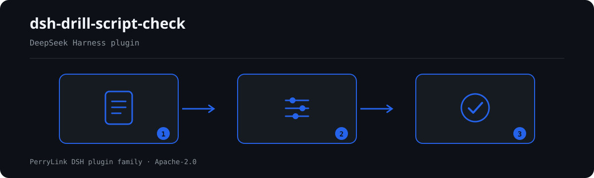

# dsh-drill-script-check — आपातकालीन अभ्यास स्क्रिप्ट की पूर्णता और अंकगणित की जाँच

[English](README.md) · [简体中文](README-zh.md) · [Español](README-es.md) · [Português](README-pt.md) · [हिन्दी](README-hi.md)

[](https://dsh.market/)
[](https://dshfind.com/en/plugins/PerryLink/dsh-drill-script-check?ref=badge)

`dsh-drill-script-check` एक आपातकालीन अभ्यास स्क्रिप्ट पढ़ता है — अभ्यास का हेडर और प्रत्येक चरण की एक पंक्ति — और उसी स्क्रिप्ट की पूर्णता तथा अंकगणित की जाँच करता है: क्या प्रत्येक चरण अपनी अभ्यास-चरण (phase) या script सामग्री दर्ज करता है, क्या वह किसी कमांडर (commander) का नाम देता है, क्या प्रतिक्रिया स्तर आपके द्वारा कॉन्फ़िगर की गई सूची से आता है, क्या script क्रिया वाला चरण अपने आवश्यक संसाधन गिनाता है, क्या चरणों की अवधियों का जोड़ अभ्यास की नियोजित अवधि के बराबर है, क्या कोई मुख्य बिंदु अपनी निर्णय-शर्त लिखता है, क्या चरण-क्रमांक दोहराए नहीं गए हैं, और क्या हेडर अभ्यास का नाम तथा आयोजक संस्था बताता है।

## Install

```sh
dsh plugin --profile <name> add dsh-drill-script-check
dsh --profile <name> --dump-config | grep 'dsh-drill-script-check'
```

## आउटपुट कैसा दिखता है



*कार्यप्रवाह: दस्तावेज़ → नियम → निष्कर्ष। नीचे के उदाहरण वास्तविक कमांड सतह का उपयोग करते हैं।*


इस प्लगइन का अपने ही `DR-007` टेस्ट फ़िक्स्चर पर वास्तविक आउटपुट — कोई नकली चित्र नहीं। नियम-पैक उद्धरण नहीं गढ़ता, इसलिए हर निष्कर्ष लागू किए गए खंड का नाम और यह भी बताता है कि उसका मूल पाठ इस बार प्राप्त नहीं हुआ।

## यह किन सवालों का जवाब देता है

### उदाहरण

नीचे दी गई तालिका उदाहरण-समुच्चय है: पहली पंक्ति विस्तृत केस है, बाकी संक्षिप्त केस हैं।


| आपका सवाल | इसका जवाब |
|---|---|
| किसी चरण में न अभ्यास-चरण भरा है और न script सामग्री। क्या यह दर्ज होता है? | हाँ। `DR-001` `phase` और `script` दोनों कॉलम एक साथ माँगता है और वह चरण दर्ज करता है जिसमें दोनों में से कोई भी नहीं भरा हो — दोनों में से एक भरा होना ही पास होने के लिए पर्याप्त है। यह देखता है कि कॉलम भरा है, यह नहीं कि क्रिया सही है या आपकी आपात योजना के अनुरूप है। |
| मैंने प्रतिक्रिया स्तर भर दिया, पर `DR-003` स्वयं को `skipped` में दर्ज करता है। क्यों? | `DR-003` `level` कॉलम की तुलना `values` में दी गई सूची से करता है, और `values` खाली आती है; इसलिए जब तक आप अपनी स्तर-सूची कॉन्फ़िगर नहीं करते, यह नियम चुपचाप पास होने के बजाय बताता है कि वह चल नहीं सका। यह केवल देखता है कि मान आपकी सूची में है — किसी घटना पर कौन-सा स्तर लागू होना चाहिए, यह कभी नहीं तय करता। |
| केवल सूचना देने वाले चरण में कोई उपकरण नहीं गिनाया गया। क्या यह दर्ज होता है? | नहीं। `DR-004` `resource` कॉलम की अपेक्षा केवल तब करता है जब उस चरण की `script` सामग्री भरी हो, इसलिए सूचना-मात्र चरण से संसाधन नहीं माँगे जाते। यह देखता है कि संसाधन गिनाए गए हैं, यह नहीं कि वे पर्याप्त हैं या मौके पर उपलब्ध साजो-सामान से मेल खाते हैं। |
| चरणों की अवधियों का जोड़ अभ्यास की नियोजित अवधि से मेल नहीं खाता। क्या यह पकड़ में आता है? | हाँ। `DR-005` चरणों के `durationMin` मानों को जोड़कर उस जोड़ की तुलना `totalDurationMin` से करता है, जिसे वह सामग्री के हेडर से लेता है — पहले पंक्ति के भीतर खोजता है, फिर हेडर पर लौट आता है। यह केवल जोड़ की जाँच है: समय-विभाजन तर्कसंगत है या पर्याप्त, यह नहीं आँकता। |
| किसी चरण के मुख्य-बिंदु कॉलम में क्या लिखा होना चाहिए? | `DR-006` अपेक्षा करता है कि चरण का `checkpoint` कॉलम — मुख्य बिंदु और उसकी निर्णय-शर्त — भरा हो। यह देखता है कि वहाँ कुछ लिखा गया है, यह नहीं कि शर्त देखने योग्य या उपयुक्त है। |
| एक ही चरण तीन क्रिया-पंक्तियों में बँटा है और उनमें से दो पर एक ही चरण-क्रमांक है। | `DR-007` दोहराया गया `stepNo` दर्ज करता है, क्योंकि दोहराव से अवधियों का जोड़ और चरणों की गिनती अविश्वसनीय हो जाती है। एक ही चरण का कई क्रिया-पंक्तियों में बँटना सामान्य है — हर पंक्ति को अपना अलग चरण-क्रमांक दें। |

## यह किन मानकों पर आधारित है

| दस्तावेज़ | संख्यांक | इन्हें उद्धृत करने वाले नियम |
|---|---|---|
| 《生产安全事故应急演练基本规范》 | YJ/T 9007—2019（原 AQ/T 9007—2019，2025 年第 1 号公告调整代号；本次未取得条文） | DR-001, DR-002, DR-004, DR-005, DR-006, DR-007, DR-008 |
| 本单位应急预案体系（本机构配置） | 无统一标准（本条依据为本机构预案的分级口径） | DR-003 |

**Boundary:** this plugin checks an **应急演练脚本** for completeness and arithmetic — that each step names its
phase and script content, that it names a commander, that the response level comes from your vocabulary, that a
step with an action lists the resources it needs, that the step durations total the drill's planned duration, that
key checkpoints state their judgement condition, that step numbers are unique, and that the script names its drill
and organiser. It does **not** decide whether a drill was realistic or effective, whether the response level was
right, whether the actions were correct, or whether the drill met its objectives.

> ### ⚠️ Read this before trusting a citation in the report
>
> **Every `excerpt` in this plugin's rule pack says, in so many words, that the clause text was not
> obtained.** The regime lives in AQ/T 9007—2019, 《生产安全事故应急条例》(国务院令第708号) and each
> institution's emergency plans. The verification pass could not retrieve verbatim clause text, so rather than
> paraphrase a quotation the pack states the gap in the `excerpt` field itself and puts the honest reasoning in
> `note`. Every rule is therefore `warn` or `info`, and a test asserts that no rule claims a quotation it does
> not have. **When the texts are in hand, replace each `excerpt` with the real clause and raise `kind` to
> `direct`.**
>
> **No response-level scale is built in.** Levels differ between plan systems — general / larger / major /
> especially major, or a unit's own Ⅰ–Ⅳ — so `DR-003` reports itself in `skipped` until you configure your
> vocabulary, and it never judges which level an event should trigger. That is the incident commander's call.
>
> The resource rule fires only when a script action is present, so a step that is purely informational is not
> asked for equipment. And the duration total is read from the header, where a drill's planned length normally
> lives.

## Compatibility

| सतह | स्थिति |
|---|---|
| Harness | peer रेंज `>=0.1.2-rc.1 <0.2.0 \|\| >=0.2.0-0 <0.3.0` — `0.2.0-rc.2` और `0.2.1-rc.2` दोनों को स्वीकार करने के लिए सत्यापित। **`engines.dsh` `>=0.2.1-0 <0.3.0` के रूप में घोषित है** और 0.2.1 से होस्ट इसे लागू करता है |
| Node | `^22.19.0 || >=24.0.0` |
| प्लेटफ़ॉर्म | सभी (शुद्ध ESM; कोई नेटिव कोड नहीं, कोई नेटवर्क नहीं, कोई मॉडल कॉल नहीं) |
| टूल मोड | `native` और `ptc` में काम करता है; पूरे फ़ोल्डर के लिए `ptc` चुनें |

## What it does

नियम-सूची, फ़ील्ड और विस्तृत व्यवहार [README.md](README.md#what-it-does) (अंग्रेज़ी मुख्य संस्करण) में हैं। यह प्लगइन केवल उद्धृत धाराओं के सामने शाब्दिक अंतर सूचीबद्ध करता है और हर न चल पाई जाँच को `skipped` में बताता है।

## Configuration

सभी समायोज्य पैरामीटर `src/config.ts` की Schemastery स्कीमा में हैं, इसलिए कोड बदले बिना `cordis.yml` से बदले जा सकते हैं; प्रति-नियम सीमाएँ `rules/` के नियम-पैक में हैं।

| कुंजी | प्रकार | डिफ़ॉल्ट | विवरण |
|---|---|---|---|
| `rulesFile` | string | `rules/drill-script-check.yaml` | नियम-पैक का पथ, पैकेज रूट के सापेक्ष |
| `disabledRules` | string[] | `[]` | बंद करने वाले नियम id; प्रत्येक `skipped` में दिखता है |
| `onlyRules` | string[] | `[]` | केवल ये नियम चलाएँ; खाली होने पर सभी नियम चलते हैं |
| `skipNotes` | string | `""` | हर `skipped` कारण के आगे जोड़ी जाने वाली टिप्पणी |
| `timeoutMs` | number | `120000` | उपकरण का सहकारी समय-सीमा बजट |

## Material format

JSON या YAML स्वीकार्य है। पूरा फ़ील्ड उदाहरण [README.md](README.md#material-format) (अंग्रेज़ी मुख्य संस्करण) में है। पढ़ने की परत में फ़ील्ड वैकल्पिक हैं और जाँच इंजन उन्हें सत्यापित करता है, इसलिए आंशिक निर्यात पर क्रैश के बजाय "अनुपस्थित" श्रेणी के निष्कर्ष मिलते हैं।

## Rule sources

नियम-डेटा कोड से अलग है: प्रत्येक नियम में दस्तावेज़, संख्या, स्रोत की अपनी क्रमांकन-प्रणाली के अनुसार धारा, शब्दशः उद्धरण और स्रोत URL होता है। लोडर लागू करता है कि उद्धरण कम से कम आठ अक्षरों का वास्तविक उद्धरण हो, और जिस जाँच का आधार केवल सामान्य सिद्धांत (`kind: derived-from-principle`, अधिकतम `warn`) या स्थानीय नीति (`kind: institutional-configuration`, अधिकतम `info`) हो, उसे कभी `error` घोषित न किया जाए।

सत्यापित सीमाएँ और जान-बूझकर **न** कहे गए निष्कर्ष [README.md](README.md#rule-sources) (अंग्रेज़ी मुख्य संस्करण) और `rules/evidence/` में हैं।

## Troubleshooting

- **प्लगइन इंस्टॉल हो गया पर टूल दिखता नहीं**: जाँचें कि `main` `lib/index.mjs` पर जाता है और `pnpm run build` ने उसे बनाया है।
- **`dsh plugin add` असंगत बताकर मना करता है**: peer range `0.1.x` और `0.2.x` दोनों को कवर करती है; बाहर होने पर स्पष्ट छूट दें: `dsh plugin --profile <name> allow-version <pkg@ver> --dsh-version <runtime> --accept-risk`।
- **कोई नियम नहीं चला**: `skipped` सरणी देखें।
- **`check` में `manifest-peers` विफल दिखता है**: यह `dsh-plugin-dev` की ज्ञात अपस्ट्रीम समस्या है; रनटाइम इंस्टॉल के समय अनुकूलता लागू करता है।
- **समय खिसका हुआ लगता है**: सारी गणना दिए गए स्ट्रिंग पर वॉल-क्लॉक है।

## Development

```sh
pnpm install
pnpm run typecheck
pnpm test
pnpm run build
node ../scripts/sync-shared.mjs dsh-drill-script-check
```

अंतिम कमांड `../_shared` का साझा किट `src/shared/` में कॉपी करता है; हर साझा बदलाव के बाद इसे दोबारा चलाएँ।

## PerryLink DSH Plugin Family

यह प्रोजेक्ट [PerryLink](https://github.com/PerryLink) के DeepSeek Harness प्लगइन परिवार का हिस्सा है। पूरी सूची नीचे संक्षिप्त रखी गई है ताकि हर README की पहली स्क्रीन छोटी रहे; हर पंक्ति और उसकी स्थिति देखने के लिए इसे खोलें।

<details>
<summary>सभी प्लगइन खोलें</summary>

| प्लगइन | स्थिति |
|---|---|
| **[dsh-aqua-input-check](https://github.com/PerryLink/dsh-aqua-input-check)** |  |
| **[dsh-archive-check](https://github.com/PerryLink/dsh-archive-check)** |  |
| **[dsh-auto-review](https://github.com/PerryLink/dsh-auto-review)** |  |
| **[dsh-autotier](https://github.com/PerryLink/dsh-autotier)** |  |
| **[dsh-bid-ca-precheck](https://github.com/PerryLink/dsh-bid-ca-precheck)** |  |
| **[dsh-bid-qual-check](https://github.com/PerryLink/dsh-bid-qual-check)** |  |
| **[dsh-cert-mcp](https://github.com/PerryLink/dsh-cert-mcp)** |  |
| **[dsh-checkpoint-rewind](https://github.com/PerryLink/dsh-checkpoint-rewind)** |  |
| **[dsh-click](https://github.com/PerryLink/dsh-click)** |  |
| **[dsh-composer-history](https://github.com/PerryLink/dsh-composer-history)** |  |
| **[dsh-contract-stance](https://github.com/PerryLink/dsh-contract-stance)** |  |
| **[dsh-customs-doc-check](https://github.com/PerryLink/dsh-customs-doc-check)** |  |
| **[dsh-data-quality](https://github.com/PerryLink/dsh-data-quality)** |  |
| **[dsh-demurrage-ledger](https://github.com/PerryLink/dsh-demurrage-ledger)** |  |
| **[dsh-doublecheck](https://github.com/PerryLink/dsh-doublecheck)** |  |
| **[dsh-drill-script-check](https://github.com/PerryLink/dsh-drill-script-check)** |  |
| **[dsh-eia-guide-check](https://github.com/PerryLink/dsh-eia-guide-check)** |  |
| **[dsh-emergency-plan](https://github.com/PerryLink/dsh-emergency-plan)** |  |
| **[dsh-essay-rubric-check](https://github.com/PerryLink/dsh-essay-rubric-check)** |  |
| **[dsh-evidence-check](https://github.com/PerryLink/dsh-evidence-check)** |  |
| **[dsh-export-ctl-check](https://github.com/PerryLink/dsh-export-ctl-check)** |  |
| **[dsh-fast](https://github.com/PerryLink/dsh-fast)** |  |
| **[dsh-fmea-table-check](https://github.com/PerryLink/dsh-fmea-table-check)** |  |
| **[dsh-forecast-penalty](https://github.com/PerryLink/dsh-forecast-penalty)** |  |
| **[dsh-fund-research](https://github.com/PerryLink/dsh-fund-research)** |  |
| **[dsh-github](https://github.com/PerryLink/dsh-github)** |  |
| **[dsh-gongwen-flow-check](https://github.com/PerryLink/dsh-gongwen-flow-check)** |  |
| **[dsh-gongwen-word-check](https://github.com/PerryLink/dsh-gongwen-word-check)** |  |
| **[dsh-guard-plan-qc](https://github.com/PerryLink/dsh-guard-plan-qc)** |  |
| **[dsh-hazchem-check](https://github.com/PerryLink/dsh-hazchem-check)** |  |
| **[dsh-hazplan-check](https://github.com/PerryLink/dsh-hazplan-check)** |  |
| **[dsh-hidden-risk-map](https://github.com/PerryLink/dsh-hidden-risk-map)** |  |
| **[dsh-hs-classify](https://github.com/PerryLink/dsh-hs-classify)** |  |
| **[dsh-icd-rule-check](https://github.com/PerryLink/dsh-icd-rule-check)** |  |
| **[dsh-industry-research](https://github.com/PerryLink/dsh-industry-research)** |  |
| **[dsh-lawcite-adapter](https://github.com/PerryLink/dsh-lawcite-adapter)** |  |
| **[dsh-laya](https://github.com/PerryLink/dsh-laya)** |  |
| **[dsh-lc-doc-check](https://github.com/PerryLink/dsh-lc-doc-check)** |  |
| **[dsh-learning-gap-check](https://github.com/PerryLink/dsh-learning-gap-check)** |  |
| **[dsh-library](https://github.com/PerryLink/dsh-library)** |  |
| **[dsh-local-ai](https://github.com/PerryLink/dsh-local-ai)** |  |
| **[dsh-lsp-actions](https://github.com/PerryLink/dsh-lsp-actions)** |  |
| **[dsh-mask](https://github.com/PerryLink/dsh-mask)** |  |
| **[dsh-mcp-panel](https://github.com/PerryLink/dsh-mcp-panel)** |  |
| **[dsh-medrec-qc](https://github.com/PerryLink/dsh-medrec-qc)** |  |
| **[dsh-memento](https://github.com/PerryLink/dsh-memento)** |  |
| **[dsh-nsfc-form-check](https://github.com/PerryLink/dsh-nsfc-form-check)** |  |
| **[dsh-nurse-record-check](https://github.com/PerryLink/dsh-nurse-record-check)** |  |
| **[dsh-observe](https://github.com/PerryLink/dsh-observe)** |  |
| **[dsh-origin-rvc-check](https://github.com/PerryLink/dsh-origin-rvc-check)** |  |
| **[dsh-ota-review-check](https://github.com/PerryLink/dsh-ota-review-check)** |  |
| **[dsh-output-styles](https://github.com/PerryLink/dsh-output-styles)** |  |
| **[dsh-paper-doc-adapter](https://github.com/PerryLink/dsh-paper-doc-adapter)** |  |
| **[dsh-permission-rules](https://github.com/PerryLink/dsh-permission-rules)** |  |
| **[dsh-permit-report-check](https://github.com/PerryLink/dsh-permit-report-check)** |  |
| **[dsh-pipeline-check](https://github.com/PerryLink/dsh-pipeline-check)** |  |
| **[dsh-pleading-draft](https://github.com/PerryLink/dsh-pleading-draft)** |  |
| **[dsh-plugin-doctor](https://github.com/PerryLink/dsh-plugin-doctor)** |  |
| **[dsh-plugin-guide](https://github.com/PerryLink/dsh-plugin-guide)** |  |
| **[dsh-plugin-kit](https://github.com/PerryLink/dsh-plugin-kit)** |  |
| **[dsh-plugin-upgrade](https://github.com/PerryLink/dsh-plugin-upgrade)** |  |
| **[dsh-policy-brief-draft](https://github.com/PerryLink/dsh-policy-brief-draft)** |  |
| **[dsh-power-loss-split](https://github.com/PerryLink/dsh-power-loss-split)** |  |
| **[dsh-power-ticket-check](https://github.com/PerryLink/dsh-power-ticket-check)** |  |
| **[dsh-ppap-check](https://github.com/PerryLink/dsh-ppap-check)** |  |
| **[dsh-protest-deadline](https://github.com/PerryLink/dsh-protest-deadline)** |  |
| **[dsh-railway-window](https://github.com/PerryLink/dsh-railway-window)** |  |
| **[dsh-repair-order-qc](https://github.com/PerryLink/dsh-repair-order-qc)** |  |
| **[dsh-research-report](https://github.com/PerryLink/dsh-research-report)** |  |
| **[dsh-review-reply-check](https://github.com/PerryLink/dsh-review-reply-check)** |  |
| **[dsh-rulefile-check](https://github.com/PerryLink/dsh-rulefile-check)** |  |
| **[dsh-safety-brief-check](https://github.com/PerryLink/dsh-safety-brief-check)** |  |
| **[dsh-score](https://github.com/PerryLink/dsh-score)** |  |
| **[dsh-session-sync](https://github.com/PerryLink/dsh-session-sync)** |  |
| **[dsh-site-log-check](https://github.com/PerryLink/dsh-site-log-check)** |  |
| **[dsh-skill-pack-security](https://github.com/PerryLink/dsh-skill-pack-security)** |  |
| **[dsh-soe-decision-check](https://github.com/PerryLink/dsh-soe-decision-check)** |  |
| **[dsh-soilwater-check](https://github.com/PerryLink/dsh-soilwater-check)** |  |
| **[dsh-sop-sync-check](https://github.com/PerryLink/dsh-sop-sync-check)** |  |
| **[dsh-spc-gbt-adapter](https://github.com/PerryLink/dsh-spc-gbt-adapter)** |  |
| **[dsh-talk](https://github.com/PerryLink/dsh-talk)** |  |
| **[dsh-tender-extract](https://github.com/PerryLink/dsh-tender-extract)** |  |
| **[dsh-tender-matrix](https://github.com/PerryLink/dsh-tender-matrix)** |  |
| **[dsh-test-drive](https://github.com/PerryLink/dsh-test-drive)** |  |
| **[dsh-ticktick](https://github.com/PerryLink/dsh-ticktick)** |  |
| **[dsh-translate](https://github.com/PerryLink/dsh-translate)** |  |
| **[dsh-warranty-calc](https://github.com/PerryLink/dsh-warranty-calc)** |  |
| **[dsh-budget](https://github.com/PerryLink/dsh-budget)** | 🧊 फ़्रोज़न — रिपॉज़िटरी README देखें |
| **[dsh-claude-move](https://github.com/PerryLink/dsh-claude-move)** | 🧊 फ़्रोज़न — रिपॉज़िटरी README देखें |
| **[dsh-defend](https://github.com/PerryLink/dsh-defend)** | 🧊 फ़्रोज़न — रिपॉज़िटरी README देखें |
| **[dsh-draw](https://github.com/PerryLink/dsh-draw)** | 🧊 फ़्रोज़न — रिपॉज़िटरी README देखें |
| **[dsh-reach](https://github.com/PerryLink/dsh-reach)** | 🧊 फ़्रोज़न — रिपॉज़िटरी README देखें |
| **[dsh-background-agents](https://github.com/PerryLink/dsh-background-agents)** | 🚫 सेवानिवृत्त — रिपॉज़िटरी README देखें |
| **[dsh-session-pin](https://github.com/PerryLink/dsh-session-pin)** | 🚫 सेवानिवृत्त — रिपॉज़िटरी README देखें |
| **[dsh-team-rooms](https://github.com/PerryLink/dsh-team-rooms)** | 🚫 सेवानिवृत्त — रिपॉज़िटरी README देखें |

</details>

## License

[Apache License 2.0](LICENSE) © 2026 dsh-drill-script-check contributors.
