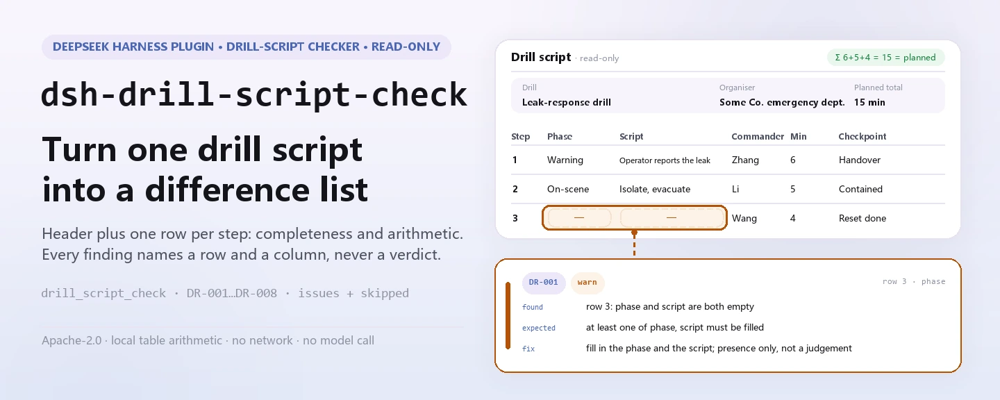

<div align="center">

<picture>
  <source media="(prefers-color-scheme: dark)" srcset="docs/assets/dsh-drill-script-check-hero-en-dark.webp">
  
</picture>

# dsh-drill-script-check

**Turn one emergency drill script into a difference list — which row, which column, what is off, and how to fix it.**

A DeepSeek Harness checker for safety and emergency managers: it reads the drill header plus one row per step and checks that script's own completeness and arithmetic. It lists only differences it can point to inside the material — no compliance verdict, no liability finding.

[Install](#three-step-setup) · [Configuration](#configuration) · [FAQ](#faq) · [简体中文](README.md) · [English](README.en.md)

[](LICENSE)
[](#compatibility)
[](https://www.npmjs.com/package/dsh-drill-script-check)
[](https://github.com/PerryLink/dsh-drill-script-check/actions/workflows/ci.yml)
[](#compatibility)

[](https://github.com/PerryLink/dsh-drill-script-check/stargazers)
[](https://www.npmjs.com/package/dsh-drill-script-check)
[](https://dshfind.com/plugins/PerryLink/dsh-drill-script-check?ref=badge)
[](https://securityscorecards.dev/viewer/?uri=github.com/PerryLink/dsh-drill-script-check)
[](https://dsh.market/)
[](https://gitee.com/perrylink/dsh-drill-script-check)

```sh
dsh plugin --profile <name> add dsh-drill-script-check
```

</div>

<sub>Community plugin, not affiliated with DeepSeek. Canonical repository: <https://github.com/PerryLink/dsh-drill-script-check> (Gitee is a mirror).</sub>

## What it is

`dsh-drill-script-check` reads one emergency drill script — the drill header plus one row per step — and checks that script's own completeness and arithmetic: that each step records its drill phase or its script content, that it names a commander, that the response level comes from the vocabulary you configure, that a step with a script action lists the resources it needs, that the step durations total the drill's planned duration, that a key checkpoint states its judgement condition, that no step number is repeated, and that the header names the drill and the organising unit. It returns a list of “which row, which column, what is off, and how to fix it”: every finding carries a `ruleId`, a `locator` (row and field), `found`, `expected`, and `fix`. An empty list does not mean “all correct” — every check that could not run is reported in `skipped` with its reason.

<picture>
  <source media="(prefers-color-scheme: dark)" srcset="docs/assets/dsh-drill-script-check-flow-v5-dark.svg">
  
</picture>

A one-minute trial (uses the bundled sample, no install needed):

```sh
node samples/quickstart/run.mjs
```

```text
drill_script_check: 1 issue(s) — error 0, warn 1, info 0
skipped: 2
```

That is the real output for `samples/quickstart/input/DR-001-unsafe.json`; the expected value lives in `samples/quickstart/expected/result.json`.

## Three-step setup

1. **Install** (pick one channel):

   ```sh
   # git channel (latest main)
   dsh plugin --profile web add github:PerryLink/dsh-drill-script-check
   # npm channel (published releases)
   dsh plugin --profile web add dsh-drill-script-check
   # tarball channel: pnpm pack in this repo, then
   dsh plugin --profile web add ./dsh-drill-script-check-<version>.tgz
   ```

   The published package ships the build output in `lib/`, so it works on install; a git-channel install builds it through `prepare`.

2. **Minimal config** (the bundle form inserts one row; no config key required):

   ```yaml
   - insert:
       - id: dsh-drill-script-check
         name: dsh-drill-script-check
   ```

   That row is the `cordis.patch.yml` referenced by `package.json#dsh.bundle.patch`; add a `config` block under it for any tunable.

3. **Verify it mounts**:

   ```sh
   dsh --profile web --dump-config | grep 'dsh-drill-script-check'
   node samples/quickstart/run.mjs --json
   ```

   ```json
   {
     "tool": "drill_script_check",
     "issueCount": 1,
     "summary": {
       "error": 0,
       "warn": 1,
       "info": 0
     },
     "skippedCount": 2
   }
   ```

**Uninstall**: `dsh plugin --profile web remove dsh-drill-script-check` (or remove the row from the profile patch).

## Core capabilities

The rule data is separate from the code: `rules/drill-script-check.yaml` declares every check, and replacing that file switches the rule-set version without touching TypeScript. Each rule is validated at load time for `document` / `number` / `clause` / `excerpt` / `kind` / `source`; a pack that overstates its basis fails at load instead of producing a confident-looking report.

| Rule | What it checks | Severity | Basis kind |
|---|---|---|---|
| `DR-001` | the drill phase or the script content is filled in | warn | derived from principle |
| `DR-002` | each step names a commander | warn | derived from principle |
| `DR-003` | the response level comes from your configured vocabulary (off by default) | info | institutional configuration |
| `DR-004` | a step with a script action lists its resources | warn | derived from principle |
| `DR-005` | step durations total the planned duration | warn | derived from principle |
| `DR-006` | a checkpoint states its judgement condition | warn | derived from principle |
| `DR-007` | step numbers are unique within the script | warn | derived from principle |
| `DR-008` | the header names the drill and the organising unit | warn | derived from principle |

### Material format

JSON or YAML. Column names are matched case-insensitively and ignoring spaces, underscores and hyphens; the script's own column names are kept, so every finding points back to the column you wrote.

```yaml
drillName: 某某装置泄漏事故应急演练
drillType: 综合演练
organizer: 某某公司应急管理部
plannedAt: 2026-06-10
totalDurationMin: '15'
rows:
  - { 序号: '1', 演练阶段: 预警与信息报告,
      脚本内容: 值班员发现泄漏报警，电话报告应急指挥部,
      指挥人: 张指挥, 参演人员: 值班员、调度员,
      所需资源: 对讲机 4 台、气体检测仪 2 台, 计划时长: '15',
      响应级别: Ⅲ级, 关键节点: 指挥部确认接报并启动响应（判定条件：指挥人下达启动指令） }
```

### Examples

**Tool** `drill_script_check`

**Input**

```json
{"rows":[{"序号":"1","演练阶段":"","脚本内容":"","指挥人":"张指挥", ...}]}
```

**Output**

```json
{
  "id": "dsh-drill-script-check.DR-001.de09b5a6",
  "ruleId": "DR-001",
  "severity": "warn",
  "locator": {
    "row": 1,
    "field": "phase"
  },
  "found": "row 1 has both phase and script empty",
  "expected": "at least one of phase and script must be filled",
  "fix": "fill in the drill phase and the script content; this rule only checks presence, not whether the action is correct"
}
```

*Observed from `dsh-drill-script-check/tests/fixtures/DR-001/DR-001-unsafe.json; dsh-drill-script-check/tests/fixtures/DR-001/cases.json; dsh-drill-script-check/rules/drill-script-check.yaml; dsh-drill-script-check/tests/index.test.ts`*

### Typical questions

| You ask | What it answers |
|---|---|
| A step has neither its drill phase nor its script content filled in. Is that reported? | Yes. `DR-001` asks for the `phase` and `script` columns together and reports the step where neither of the two is filled — one of them is enough to pass. It checks that the column is filled, not whether the action is correct or matches your emergency plan. |
| I filled in the response level, but `DR-003` reports itself in `skipped`. Why? | `DR-003` compares the `level` column with the vocabulary in `values`, which ships empty, so until you configure your own levels the rule reports that it could not run instead of passing silently. It only checks that the value is one of yours — it never judges which level an event should trigger. |
| A step that is purely informational lists no equipment. Is that flagged? | No. `DR-004` asks for the `resource` column only when that step's `script` content is filled, so an informational step is not asked for equipment. It checks that the resources are listed, not that they are sufficient or that they match what is actually on site. |
| The step durations do not add up to the drill's planned duration. Will the check catch it? | Yes. `DR-005` adds the `durationMin` values of the steps and compares that total with `totalDurationMin`, which it takes from the header of the material — it looks inside the row first and falls back to the header. It is an addition check only: it does not judge whether the time arrangement is reasonable or sufficient. |
| What must the checkpoint column of a step contain? | `DR-006` requires the `checkpoint` column — the key node together with its judgement condition — to be filled on the step. It checks that something has been written there, not that the condition is observable or appropriate. |
| One phase is split over three action rows and two of them carry the same step number. | `DR-007` reports the repeated `stepNo`, because a repeat makes the duration total and the step count unreliable. Splitting one phase into several action rows is normal — give each row its own step number. |

## Configuration

Every tunable is a Schemastery field in `src/config.ts`, changeable from `cordis.yml` without touching code; per-rule thresholds live in the rule pack under `rules/`.

| Key | Type | Default | Description |
|---|---|---|---|
| `rulesFile` | string | `rules/drill-script-check.yaml` | Rule-pack path, relative to the package root |
| `disabledRules` | string[] | `[]` | Rule ids to stop running; each appears in `skipped` |
| `onlyRules` | string[] | `[]` | Run only these rule ids; empty runs every rule |
| `skipNotes` | string | `""` | Note appended to every `skipped` reason, e.g. citing your institution's implementation rules |
| `timeoutMs` | number | `120000` | Cooperative tool timeout budget |

Rule-level parameters worth knowing:

- `DR-003` `values` — your response levels, e.g. `[Ⅰ, Ⅱ, Ⅲ, Ⅳ]`. Empty means no check, and the rule reports itself in `skipped`.
- `DR-005` `field` / `headerField` / `tolerance` — the duration column, the header total it must match, and the tolerance (default `0.01`).
- `DR-004` `conditionField` / `requiredFields` — what triggers the resource requirement and which columns it requires.
- `DR-008` `fields` — the header fields that must be declared, `[drillName, organizer]` by default.

Example override in your profile patch:

```yaml
- insert:
    - id: dsh-drill-script-check
      name: dsh-drill-script-check
      config:
        onlyRules: [DR-001, DR-004, DR-005, DR-007]
        skipNotes: institution implementation rules, 2026 edition
```

## FAQ

<details>
<summary>Where does the material go? What does the plugin read and write?</summary>

It reads only the `file` you pass (or inline `material`); it writes no files, makes no network request, and calls no model. The report comes back as `markdown` and `reportJson`. The manifest's demo declares reads of “the material file the user specifies” only, and writes of nothing.

</details>

<details>
<summary>The report lists no issue at all — does that mean the script is fine?</summary>

No. Every check that could not run is listed in `skipped` with its reason; `DR-003`, for instance, ships with an empty `values` and reports `skipped` until you configure your levels, rather than passing silently. An empty issue list only means “the checks that did run found no difference”.

</details>

<details>
<summary>`DR-005` says the durations do not add up, but they look fine to me?</summary>

It sums the `durationMin` cells and compares the total with the header `totalDurationMin`, with a `0.01` tolerance. The usual causes are a missing step row or a mistyped figure. It is an addition check only: it does not judge whether the time arrangement is reasonable or sufficient.

</details>

<details>
<summary>Does it fight other plugins over tool names, service keys, or events?</summary>

No. It registers one namespaced tool, `drill_script_check`; it provides no service key, registers no client slot and no `webServer` route, and listens to no shared event. The bundle patch only `insert`s its own row. The point-by-point argument is in “Interoperability with other DSH plugins”.

</details>

<details>
<summary>How big is the performance overhead?</summary>

Pure local table arithmetic: no network request, no model call, no native dependency. `timeoutMs` defaults to `120000` ms as a cooperative timeout budget; it does not change the check logic.

</details>

## Security boundaries & known limitations

**Boundary:** this plugin checks an **emergency drill script** for completeness and arithmetic — that each step names its phase and script content, that it names a commander, that the response level comes from your vocabulary, that a step with an action lists the resources it needs, that the step durations total the drill's planned duration, that key checkpoints state their judgement condition, that step numbers are unique, and that the script names its drill and organiser. It does **not** decide whether a drill was realistic or effective, whether the response level was right, whether the actions were correct, or whether the drill met its objectives.

- **No compliance or liability verdict.** It lists only differences it can point to inside the material; the conclusion is the reviewer's.
- **The clause text was not obtained.** The verbatim clauses of YJ/T 9007—2019 could not be obtained; each rule's `excerpt` says so and its `kind` is `derived-from-principle` (severity capped at `warn`) or `institutional-configuration` (capped at `info`). Once the text is in hand, replace the `excerpt` with the real clause and raise `kind` to `direct`.
- **No built-in response levels.** `DR-003` ships with an empty `values`; fill it with your emergency plans' scale. The plugin only checks that a value is on your list — it never judges which level an event should trigger.
- **Column matching is lenient.** Field names ignore case, spaces, underscores and hyphens; the report keeps the script's own column names, so a difference points back to your header.
- **`DR-005` needs the header total.** Without `totalDurationMin` in the header, or without any step recording a duration, the rule reports itself in `skipped`.
- **`check` may report `manifest-peers` as failed.** The static checker compares against a hard-coded peer range that predates the 0.2 line; the runtime enforces peer compatibility at install time, so the declared range is the correct one. This is a known upstream issue in `dsh-plugin-dev`.

### Troubleshooting

- **The plugin installs but the tool never appears.** Check that `main` resolves to `lib/index.mjs` and that `pnpm run build` produced it; a wrong `main` makes the loader skip the entry silently.
- **`dsh plugin add` refuses the package as incompatible.** The peer range covers `0.1.x` and `0.2.x`; if your runtime sits outside it, grant an explicit exemption: `dsh plugin --profile <name> allow-version dsh-drill-script-check@0.1.0 --dsh-version <runtime> --accept-risk`.
- **A rule did not run.** Look in the `skipped` array; it names the rule id and the reason.
- **Times look shifted.** Every calculation is wall-clock arithmetic on the input strings; no time-zone conversion is performed.

### Interoperability with other DSH plugins

- **No tool-name collision.** It registers exactly one namespaced tool, `drill_script_check`; it occupies no bare name owned by a built-in tool or another plugin.
- **No service-key, slot, or route collision.** It provides no service key, registers no client slot, and registers no `webServer` prefix.
- **No shared-event listeners.** It listens to no ordering-sensitive event such as `agent/pre-step` or `tools/post-execute`, so it takes part in no chain and short-circuits no one else's result.
- **No patch-layer collision.** The bundle patch only `insert`s its own row; it never overrides a built-in row's `config`.
- **No global mutation.** It does not patch prototypes, rewrite `process.env`, or replace the global fetch dispatcher.

## Sources & citations

| Document | Number | Cited by rules |
|---|---|---|
| Basic Specification for Emergency Drills of Production Safety Accidents | YJ/T 9007—2019 (formerly AQ/T 9007—2019, code changed by Announcement No. 1 of 2025; the clause text was not obtained this time) | DR-001, DR-002, DR-004, DR-005, DR-006, DR-007, DR-008 |
| This institution's emergency-plan system (local configuration) | No common standard (this rule rests on the institution's own response-level vocabulary) | DR-003 |

> ### Read this before trusting a citation in the report
>
> **`excerpt` status is per rule, not uniform.** Some rules quote the clause verbatim (`kind: direct`), some are derived from the principle of the cited articles (`kind: derived-from-principle`, capped at `warn`), and some use thresholds your institution configures (`kind: institutional-configuration`, capped at `info`). The pack never paraphrases a quotation: when the text was not obtained, the `excerpt` field says so and the reasoning lives in `note`; a test asserts that no rule claims a quotation it does not have. **For any rule still marked as not obtained, replace the `excerpt` with the real clause and raise `kind` to `direct` once the text is in hand.**
>
> The conclusion is the reviewer's: this plugin lists differences it can point to in the material and does not decide facts or compliance.

Rule data lives in `rules/drill-script-check.yaml`. The pack's header states the citation gap in full, and each rule's `note` repeats the part that matters for that rule. The load-time guard that normally enforces “an excerpt must be a real quotation of at least eight characters” cannot tell a quotation from a description — so this pack leans on the header, the per-rule notes and a test that asserts every `excerpt` admits the gap.

## Compatibility

| Surface | Status |
|---|---|
| Harness | Peer range `>=0.1.2-rc.1 <0.2.0 \|\| >=0.2.0-0 <0.3.0` — verified to accept both `0.2.0-rc.2` and `0.2.1-rc.2`. `engines.dsh` is declared as `>=0.2.1-0 <0.3.0` and is enforced by the host since 0.2.1 |
| Node | `^22.19.0 \|\| >=24.0.0` |
| Platforms | All (plain ESM; no native code, no network, no model call) |
| Tool mode | Works in `native` and `ptc`; for a full directory use `ptc`, so the schema cost is paid once |

## Ecosystem & quality

- [Gitee mirror](https://gitee.com/perrylink/dsh-drill-script-check) (sync mirror; GitHub is canonical)
- [dshfind plugin page](https://dshfind.com/plugins/PerryLink/dsh-drill-script-check) (installs and ranking)
- [OpenSSF Scorecard report](https://securityscorecards.dev/viewer/?uri=github.com/PerryLink/dsh-drill-script-check) (driven by [.github/workflows/scorecard.yml](.github/workflows/scorecard.yml))
- [DSH Market](https://dsh.market/) (listed)
- [Ecosystem knowledge base](https://perrylink.github.io/dsh-plugin-guide/): plugin development guide · selection data · maintenance criteria

## Development

```sh
pnpm install
pnpm run typecheck                       # tsc --noEmit
pnpm test                                # vitest, the shared table-plugin suite plus paired fixtures
pnpm run build                           # tsdown -> lib/index.mjs + lib/index.d.mts
pnpm run verify:self-contained           # dependency specs resolve from the registry
pnpm run check:lockfile                  # lockfile drift
pnpm run check:readmes                   # README consistency
pnpm run check:citations                 # citation-verification baseline
pnpm pack                                # the published tarball
```

`prepublishOnly` re-runs the whole gate, so a release cannot ship an unbuilt or drifted tree.

The plugin is **data-only**: `src/model.ts` declares the table shape and material contract, the shared kit supplies the reader and the check engine, and the rule pack declares every check. Adding a check that fits an existing kind is a rule-pack edit, not a code change.

| Path | Role |
|---|---|
| `src/index.ts` | Function-plugin contract (`name` / `inject` / `Config` / `apply`, no default export); registers the `drill_script_check` tool and resolves the packaged rule pack |
| `src/config.ts` | Schemastery schema; every tunable lives here |
| `src/model.ts` | Table shape and material contract: the column-alias map and the canonical-to-header field map |
| `src/view.ts` | The model-facing projection of a report; `output.schema` mirrors it |
| `src/shared/` | The shared kit (reader, table check engine, ruleset loader, report shape, YAML subset, calendar arithmetic, wording guard, table helpers); copied in, not imported |
| `rules/drill-script-check.yaml` | The rule pack, 8 rules |
| `rules/evidence/` | The clause-verification record for every citation (`clause-verification-yj9007.md`) |
| `tests/` | vitest; paired compliant/violating fixtures per rule, plus boundary-semantics tests and the shared table suite |
| `samples/quickstart/` | The one-minute trial sample and its expected output |
| `scripts/` | Mechanical gates and README asset generation |

README images: `docs/assets/dsh-drill-script-check-hero-{zh,en}-{light,dark}.webp` and `docs/assets/dsh-drill-script-check-flow-v5-{light,dark}.svg` are generated programmatically by [`scripts/gen-readme-assets.py`](scripts/gen-readme-assets.py) (Pillow draws the localized hero, a hand-written SVG draws the rule × field matrix). The structure diagram carries command-surface tokens, rule and field identifiers, and short English notes only, so all five languages share it:

```sh
python scripts/gen-readme-assets.py
```

This repository has no benchmark data, so no evidence bar chart is generated.

## Family & thanks

This project is part of the DeepSeek Harness plugin family from [PerryLink](https://github.com/PerryLink) (all Apache-2.0). If it is useful, **a star helps the next person find it** — nothing is gated behind it.

- [@PerryLink](https://github.com/PerryLink) — creator and maintainer: the rule pack and check engine, and the five-language docs.

<details>
<summary>Expand all plugins</summary>

| Plugin | Status |
|---|---|
| **[dsh-aqua-input-check](https://github.com/PerryLink/dsh-aqua-input-check)** |  |
| **[dsh-archive-check](https://github.com/PerryLink/dsh-archive-check)** |  |
| **[dsh-auto-review](https://github.com/PerryLink/dsh-auto-review)** |  |
| **[dsh-autotier](https://github.com/PerryLink/dsh-autotier)** | 🧊 FROZEN — see the repo README |
| **[dsh-bid-ca-precheck](https://github.com/PerryLink/dsh-bid-ca-precheck)** |  |
| **[dsh-bid-qual-check](https://github.com/PerryLink/dsh-bid-qual-check)** |  |
| **[dsh-cert-mcp](https://github.com/PerryLink/dsh-cert-mcp)** | 🧊 FROZEN — see the repo README |
| **[dsh-checkpoint-rewind](https://github.com/PerryLink/dsh-checkpoint-rewind)** |  |
| **[dsh-click](https://github.com/PerryLink/dsh-click)** |  |
| **[dsh-composer-history](https://github.com/PerryLink/dsh-composer-history)** |  |
| **[dsh-contract-stance](https://github.com/PerryLink/dsh-contract-stance)** |  |
| **[dsh-customs-doc-check](https://github.com/PerryLink/dsh-customs-doc-check)** |  |
| **[dsh-data-quality](https://github.com/PerryLink/dsh-data-quality)** | 🧊 FROZEN — see the repo README |
| **[dsh-demurrage-ledger](https://github.com/PerryLink/dsh-demurrage-ledger)** |  |
| **[dsh-doublecheck](https://github.com/PerryLink/dsh-doublecheck)** |  |
| **[dsh-drill-script-check](https://github.com/PerryLink/dsh-drill-script-check)** |  |
| **[dsh-eia-guide-check](https://github.com/PerryLink/dsh-eia-guide-check)** |  |
| **[dsh-emergency-plan](https://github.com/PerryLink/dsh-emergency-plan)** |  |
| **[dsh-essay-rubric-check](https://github.com/PerryLink/dsh-essay-rubric-check)** |  |
| **[dsh-evidence-check](https://github.com/PerryLink/dsh-evidence-check)** |  |
| **[dsh-export-ctl-check](https://github.com/PerryLink/dsh-export-ctl-check)** |  |
| **[dsh-fast](https://github.com/PerryLink/dsh-fast)** |  |
| **[dsh-fmea-table-check](https://github.com/PerryLink/dsh-fmea-table-check)** |  |
| **[dsh-forecast-penalty](https://github.com/PerryLink/dsh-forecast-penalty)** |  |
| **[dsh-fund-research](https://github.com/PerryLink/dsh-fund-research)** |  |
| **[dsh-github](https://github.com/PerryLink/dsh-github)** |  |
| **[dsh-gongwen-flow-check](https://github.com/PerryLink/dsh-gongwen-flow-check)** |  |
| **[dsh-gongwen-word-check](https://github.com/PerryLink/dsh-gongwen-word-check)** |  |
| **[dsh-guard-plan-qc](https://github.com/PerryLink/dsh-guard-plan-qc)** |  |
| **[dsh-hazchem-check](https://github.com/PerryLink/dsh-hazchem-check)** |  |
| **[dsh-hazplan-check](https://github.com/PerryLink/dsh-hazplan-check)** |  |
| **[dsh-hidden-risk-map](https://github.com/PerryLink/dsh-hidden-risk-map)** |  |
| **[dsh-hs-classify](https://github.com/PerryLink/dsh-hs-classify)** |  |
| **[dsh-icd-rule-check](https://github.com/PerryLink/dsh-icd-rule-check)** |  |
| **[dsh-industry-research](https://github.com/PerryLink/dsh-industry-research)** |  |
| **[dsh-lawcite-adapter](https://github.com/PerryLink/dsh-lawcite-adapter)** |  |
| **[dsh-laya](https://github.com/PerryLink/dsh-laya)** |  |
| **[dsh-lc-doc-check](https://github.com/PerryLink/dsh-lc-doc-check)** |  |
| **[dsh-learning-gap-check](https://github.com/PerryLink/dsh-learning-gap-check)** |  |
| **[dsh-library](https://github.com/PerryLink/dsh-library)** |  |
| **[dsh-local-ai](https://github.com/PerryLink/dsh-local-ai)** |  |
| **[dsh-lsp-actions](https://github.com/PerryLink/dsh-lsp-actions)** |  |
| **[dsh-mask](https://github.com/PerryLink/dsh-mask)** |  |
| **[dsh-mcp-panel](https://github.com/PerryLink/dsh-mcp-panel)** |  |
| **[dsh-medrec-qc](https://github.com/PerryLink/dsh-medrec-qc)** |  |
| **[dsh-memento](https://github.com/PerryLink/dsh-memento)** | 🧊 FROZEN — see the repo README |
| **[dsh-nsfc-form-check](https://github.com/PerryLink/dsh-nsfc-form-check)** |  |
| **[dsh-nurse-record-check](https://github.com/PerryLink/dsh-nurse-record-check)** |  |
| **[dsh-observe](https://github.com/PerryLink/dsh-observe)** |  |
| **[dsh-origin-rvc-check](https://github.com/PerryLink/dsh-origin-rvc-check)** |  |
| **[dsh-ota-review-check](https://github.com/PerryLink/dsh-ota-review-check)** |  |
| **[dsh-output-styles](https://github.com/PerryLink/dsh-output-styles)** |  |
| **[dsh-paper-doc-adapter](https://github.com/PerryLink/dsh-paper-doc-adapter)** |  |
| **[dsh-permission-rules](https://github.com/PerryLink/dsh-permission-rules)** |  |
| **[dsh-permit-report-check](https://github.com/PerryLink/dsh-permit-report-check)** |  |
| **[dsh-pipeline-check](https://github.com/PerryLink/dsh-pipeline-check)** |  |
| **[dsh-pleading-draft](https://github.com/PerryLink/dsh-pleading-draft)** |  |
| **[dsh-plugin-doctor](https://github.com/PerryLink/dsh-plugin-doctor)** | 🚫 RETIRED (repo archived) |
| **[dsh-plugin-guide](https://github.com/PerryLink/dsh-plugin-guide)** |  |
| **[dsh-plugin-kit](https://github.com/PerryLink/dsh-plugin-kit)** | 🚫 RETIRED (repo archived) |
| **[dsh-plugin-upgrade](https://github.com/PerryLink/dsh-plugin-upgrade)** | 🚫 RETIRED (repo archived) |
| **[dsh-policy-brief-draft](https://github.com/PerryLink/dsh-policy-brief-draft)** |  |
| **[dsh-power-loss-split](https://github.com/PerryLink/dsh-power-loss-split)** |  |
| **[dsh-power-ticket-check](https://github.com/PerryLink/dsh-power-ticket-check)** |  |
| **[dsh-ppap-check](https://github.com/PerryLink/dsh-ppap-check)** |  |
| **[dsh-protest-deadline](https://github.com/PerryLink/dsh-protest-deadline)** |  |
| **[dsh-railway-window](https://github.com/PerryLink/dsh-railway-window)** |  |
| **[dsh-repair-order-qc](https://github.com/PerryLink/dsh-repair-order-qc)** |  |
| **[dsh-research-report](https://github.com/PerryLink/dsh-research-report)** |  |
| **[dsh-review-reply-check](https://github.com/PerryLink/dsh-review-reply-check)** |  |
| **[dsh-rulefile-check](https://github.com/PerryLink/dsh-rulefile-check)** |  |
| **[dsh-safety-brief-check](https://github.com/PerryLink/dsh-safety-brief-check)** |  |
| **[dsh-score](https://github.com/PerryLink/dsh-score)** | 🧊 FROZEN — see the repo README |
| **[dsh-session-sync](https://github.com/PerryLink/dsh-session-sync)** |  |
| **[dsh-site-log-check](https://github.com/PerryLink/dsh-site-log-check)** |  |
| **[dsh-skill-pack-security](https://github.com/PerryLink/dsh-skill-pack-security)** |  |
| **[dsh-soe-decision-check](https://github.com/PerryLink/dsh-soe-decision-check)** |  |
| **[dsh-soilwater-check](https://github.com/PerryLink/dsh-soilwater-check)** |  |
| **[dsh-sop-sync-check](https://github.com/PerryLink/dsh-sop-sync-check)** |  |
| **[dsh-spc-gbt-adapter](https://github.com/PerryLink/dsh-spc-gbt-adapter)** |  |
| **[dsh-talk](https://github.com/PerryLink/dsh-talk)** |  |
| **[dsh-tender-extract](https://github.com/PerryLink/dsh-tender-extract)** |  |
| **[dsh-tender-matrix](https://github.com/PerryLink/dsh-tender-matrix)** |  |
| **[dsh-test-drive](https://github.com/PerryLink/dsh-test-drive)** |  |
| **[dsh-ticktick](https://github.com/PerryLink/dsh-ticktick)** | 🚫 RETIRED (repo archived) |
| **[dsh-translate](https://github.com/PerryLink/dsh-translate)** |  |
| **[dsh-warranty-calc](https://github.com/PerryLink/dsh-warranty-calc)** |  |
| **[dsh-budget](https://github.com/PerryLink/dsh-budget)** | 🧊 FROZEN — see the repo README |
| **[dsh-claude-move](https://github.com/PerryLink/dsh-claude-move)** | 🧊 FROZEN — see the repo README |
| **[dsh-defend](https://github.com/PerryLink/dsh-defend)** | 🧊 FROZEN — see the repo README |
| **[dsh-draw](https://github.com/PerryLink/dsh-draw)** | 🧊 FROZEN — see the repo README |
| **[dsh-reach](https://github.com/PerryLink/dsh-reach)** | 🧊 FROZEN — see the repo README |
| **[dsh-background-agents](https://github.com/PerryLink/dsh-background-agents)** | 🚫 RETIRED (repo archived) |
| **[dsh-session-pin](https://github.com/PerryLink/dsh-session-pin)** | 🚫 RETIRED (repo archived) |
| **[dsh-team-rooms](https://github.com/PerryLink/dsh-team-rooms)** | 🚫 RETIRED (repo archived) |

</details>

## License

[LICENSE](LICENSE) (Apache License 2.0) © 2026 dsh-drill-script-check contributors

<p align="center"><sub>Apache-2.0 · Community plugin, not affiliated with DeepSeek.</sub></p>
