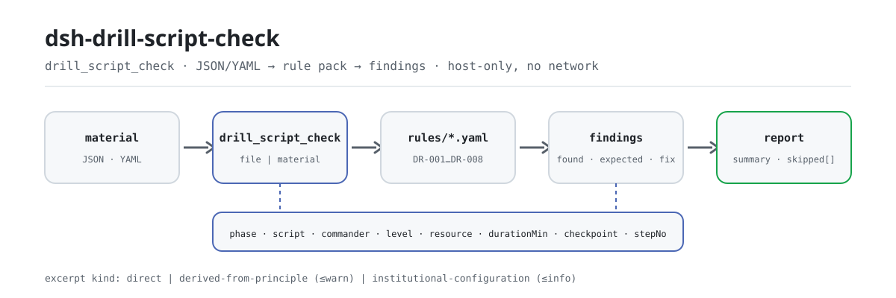

<div align="center">

<picture>
  <source media="(prefers-color-scheme: dark)" srcset="docs/assets/dsh-drill-script-check-flow-dark.svg">
  
</picture>

# dsh-drill-script-check

**Convierte un guion de simulacro de emergencia en una lista de diferencias: qué fila, qué columna, qué falta y cómo corregirlo.**

Un verificador de DeepSeek Harness para responsables de seguridad y de gestión de emergencias: lee la cabecera del simulacro más una fila por etapa y comprueba la completitud y la aritmética del propio guion. Solo enumera las diferencias que puede señalar dentro del material: no dictamina cumplimiento ni atribuye responsabilidad.

[Instalar](#instalación-en-tres-pasos) · [Configuración](#configuración) · [FAQ](#faq) · [简体中文](README.md) · [English](README.en.md) · [Español](README.es.md) · [Português](README.pt.md) · [हिन्दी](README.hi.md)

[](LICENSE)
[](#compatibilidad)
[](https://www.npmjs.com/package/dsh-drill-script-check)
[](https://github.com/PerryLink/dsh-drill-script-check/actions/workflows/ci.yml)
[](#compatibilidad)

[](https://github.com/PerryLink/dsh-drill-script-check/stargazers)
[](https://www.npmjs.com/package/dsh-drill-script-check)
[](https://dshfind.com/plugins/PerryLink/dsh-drill-script-check?ref=badge)
[](https://securityscorecards.dev/viewer/?uri=github.com/PerryLink/dsh-drill-script-check)
[](https://dsh.market/)
[](https://gitee.com/perrylink/dsh-drill-script-check)

```sh
dsh plugin --profile <name> add dsh-drill-script-check
```

</div>

<sub>Plugin de la comunidad, no afiliado a DeepSeek. Repositorio canónico: <https://github.com/PerryLink/dsh-drill-script-check> (Gitee es un espejo).</sub>

## Qué es

`dsh-drill-script-check` lee un guion de simulacro de emergencia —la cabecera del simulacro más una fila por etapa— y comprueba la completitud y la aritmética de ese guion: que cada etapa registre su fase de simulacro o su contenido de guion, que nombre a un responsable de mando, que el nivel de respuesta proceda del vocabulario que usted configure, que una etapa con acción de guion enumere los recursos que necesita, que las duraciones de las etapas sumen la duración prevista del simulacro, que un punto clave declare su condición de juicio, que no se repita ningún número de etapa y que la cabecera nombre el simulacro y la entidad organizadora. Devuelve una lista de «qué fila, qué columna, qué falta y cómo corregirlo»: cada hallazgo lleva `ruleId`, `locator` (fila y campo), `found`, `expected` y `fix`. Una lista vacía no significa «todo correcto»: toda comprobación que no pudo ejecutarse se informa en `skipped` con su motivo.

Prueba de un minuto (usa el ejemplo incluido, sin instalar nada):

```sh
node samples/quickstart/run.mjs
```

```text
drill_script_check: 1 issue(s) — error 0, warn 1, info 0
skipped: 2
```

Es la salida real para `samples/quickstart/input/DR-001-unsafe.json`; el valor esperado está en `samples/quickstart/expected/result.json`.

## Instalación en tres pasos

1. **Instala** (elige un canal):

   ```sh
   # canal git (último main)
   dsh plugin --profile web add github:PerryLink/dsh-drill-script-check
   # canal npm (versiones publicadas)
   dsh plugin --profile web add dsh-drill-script-check
   # canal tarball: pnpm pack en este repo y luego
   dsh plugin --profile web add ./dsh-drill-script-check-<version>.tgz
   ```

   El paquete publicado incluye el artefacto de compilación en `lib/`, así que funciona al instalar; una instalación por git lo compila mediante `prepare`.

2. **Configuración mínima** (la forma bundle inserta una fila; no requiere ninguna clave):

   ```yaml
   - insert:
       - id: dsh-drill-script-check
         name: dsh-drill-script-check
   ```

   Esa fila es el `cordis.patch.yml` al que apunta `package.json#dsh.bundle.patch`; añada un bloque `config` debajo para cualquier ajuste.

3. **Verifica que se monta**:

   ```sh
   dsh --profile web --dump-config | grep 'dsh-drill-script-check'
   node samples/quickstart/run.mjs --json
   ```

   ```json
   {
     "tool": "drill_script_check",
     "issueCount": 1,
     "summary": {
       "error": 0,
       "warn": 1,
       "info": 0
     },
     "skippedCount": 2
   }
   ```

**Desinstalar**: `dsh plugin --profile web remove dsh-drill-script-check` (o elimine la fila del patch del perfil).

## Capacidades clave

Los datos de las reglas están separados del código: `rules/drill-script-check.yaml` declara cada comprobación y sustituir ese archivo cambia la versión del conjunto de reglas sin tocar TypeScript. Cada regla se valida al cargar en `document` / `number` / `clause` / `excerpt` / `kind` / `source`; un paquete que exagere su fundamento falla al cargar en lugar de producir un informe que parezca sólido.

| Regla | Qué comprueba | Nivel | Tipo de fundamento |
|---|---|---|---|
| `DR-001` | se rellena la fase de simulacro o el contenido de guion | warn | derivado de principio |
| `DR-002` | cada etapa nombra a un responsable de mando | warn | derivado de principio |
| `DR-003` | el nivel de respuesta procede del vocabulario configurado (desactivado por defecto) | info | configuración institucional |
| `DR-004` | una etapa con acción de guion enumera sus recursos | warn | derivado de principio |
| `DR-005` | las duraciones de las etapas suman la duración prevista | warn | derivado de principio |
| `DR-006` | un punto clave declara su condición de juicio | warn | derivado de principio |
| `DR-007` | los números de etapa son únicos en el guion | warn | derivado de principio |
| `DR-008` | la cabecera nombra el simulacro y la entidad organizadora | warn | derivado de principio |

### Formato del material

Acepta JSON o YAML. Los nombres de columna se comparan sin distinguir mayúsculas y ignorando espacios, guiones bajos y guiones; se conservan los nombres de columna del guion, así que cada hallazgo apunta a la columna que usted escribió.

```yaml
drillName: 某某装置泄漏事故应急演练
drillType: 综合演练
organizer: 某某公司应急管理部
plannedAt: 2026-06-10
totalDurationMin: '15'
rows:
  - { 序号: '1', 演练阶段: 预警与信息报告,
      脚本内容: 值班员发现泄漏报警，电话报告应急指挥部,
      指挥人: 张指挥, 参演人员: 值班员、调度员,
      所需资源: 对讲机 4 台、气体检测仪 2 台, 计划时长: '15',
      响应级别: Ⅲ级, 关键节点: 指挥部确认接报并启动响应（判定条件：指挥人下达启动指令） }
```

### Ejemplos

**Herramienta** `drill_script_check`

**Entrada**

```json
{"rows":[{"序号":"1","演练阶段":"","脚本内容":"","指挥人":"张指挥", ...}]}
```

**Salida**

```json
{
  "id": "dsh-drill-script-check.DR-001.de09b5a6",
  "ruleId": "DR-001",
  "severity": "warn",
  "locator": {
    "row": 1,
    "field": "phase"
  },
  "found": "la fila 1 tiene phase y script vacíos",
  "expected": "debe rellenarse al menos uno de phase y script",
  "fix": "complete la fase de simulacro y el contenido de guion; esta regla solo comprueba que estén rellenos, no si la acción es correcta"
}
```

*Observed from `dsh-drill-script-check/tests/fixtures/DR-001/DR-001-unsafe.json; dsh-drill-script-check/tests/fixtures/DR-001/cases.json; dsh-drill-script-check/rules/drill-script-check.yaml; dsh-drill-script-check/tests/index.test.ts`*

### Preguntas típicas

| Usted pregunta | Qué responde |
|---|---|
| Una etapa no tiene ni fase de simulacro ni contenido de guion. ¿Se informa? | Sí. `DR-001` pide juntas las columnas `phase` y `script` e informa de la etapa en la que no se ha rellenado ninguna de las dos: basta con una. Comprueba que la columna esté rellena, no si la acción es correcta o coincide con su plan de emergencia. |
| He rellenado el nivel de respuesta, pero `DR-003` aparece en `skipped`. ¿Por qué? | `DR-003` compara la columna `level` con el vocabulario de `values`, que viene vacío; hasta que configure sus propios niveles, la regla informa que no pudo ejecutarse en lugar de aprobar en silencio. Solo comprueba que el valor esté en su lista: nunca juzga qué nivel debería activar un evento. |
| Una etapa meramente informativa no enumera equipos. ¿Se marca? | No. `DR-004` pide la columna `resource` solo cuando el contenido `script` de esa etapa está relleno, así que una etapa informativa no necesita enumerar recursos. Comprueba que los recursos estén enumerados, no que sean suficientes ni que coincidan con lo que hay en el lugar. |
| Las duraciones de las etapas no suman la duración prevista del simulacro. ¿Se detecta? | Sí. `DR-005` suma los valores `durationMin` de las etapas y compara el total con `totalDurationMin`, que toma de la cabecera del material: busca primero en la fila y recurre a la cabecera. Es solo una comprobación aritmética: no juzga si la distribución del tiempo es razonable o suficiente. |
| ¿Qué debe contener la columna de punto clave de una etapa? | `DR-006` exige que la columna `checkpoint` —el nodo clave junto con su condición de juicio— esté rellena en la etapa. Comprueba que se haya escrito algo, no que la condición sea observable o adecuada. |
| Una fase se divide en tres filas de acción y dos llevan el mismo número de etapa. | `DR-007` informa del `stepNo` repetido, porque una repetición hace poco fiables el total de duración y el recuento de etapas. Dividir una fase en varias filas de acción es normal: dé a cada fila su propio número. |

## Configuración

Todos los ajustes son campos Schemastery de `src/config.ts`, modificables desde `cordis.yml` sin tocar código; los umbrales por regla viven en el paquete de reglas bajo `rules/`.

| Clave | Tipo | Valor por defecto | Descripción |
|---|---|---|---|
| `rulesFile` | string | `rules/drill-script-check.yaml` | Ruta del paquete de reglas, relativa a la raíz del paquete |
| `disabledRules` | string[] | `[]` | Ids de reglas que se dejan de ejecutar; cada una aparece en `skipped` |
| `onlyRules` | string[] | `[]` | Ejecutar solo estos ids; vacío ejecuta todas las reglas |
| `skipNotes` | string | `""` | Nota añadida a cada motivo de `skipped`, p. ej. las normas de aplicación de su institución |
| `timeoutMs` | number | `120000` | Presupuesto de tiempo de espera cooperativo de la herramienta |

Parámetros por regla que conviene conocer:

- `DR-003` `values` — sus niveles de respuesta, p. ej. `[Ⅰ级, Ⅱ级, Ⅲ级, Ⅳ级]`. Vacío significa sin comprobación, y la regla se informa en `skipped`.
- `DR-005` `field` / `headerField` / `tolerance` — la columna de duración, el total de cabecera con el que debe coincidir y la tolerancia (por defecto `0.01`).
- `DR-004` `conditionField` / `requiredFields` — qué activa la exigencia de recursos y qué columnas exige.
- `DR-008` `fields` — los campos de cabecera que deben declararse, `[drillName, organizer]` por defecto.

Ejemplo de sustitución en el patch del perfil:

```yaml
- insert:
    - id: dsh-drill-script-check
      name: dsh-drill-script-check
      config:
        onlyRules: [DR-001, DR-004, DR-005, DR-007]
        skipNotes: normas de aplicación de la institución, edición 2026
```

## FAQ

<details>
<summary>¿Adónde va el material? ¿Qué lee y escribe el plugin?</summary>

Solo lee el `file` que usted pasa (o el `material` en línea); no escribe archivos, no hace peticiones de red y no llama a ningún modelo. El informe vuelve como `markdown` y `reportJson`. El demo del manifiesto declara únicamente la lectura de «el archivo de material que indica el usuario» y ninguna escritura.

</details>

<details>
<summary>El informe no muestra ningún problema. ¿Significa que el guion está bien?</summary>

No. Toda comprobación que no pudo ejecutarse se enumera en `skipped` con su motivo; `DR-003`, por ejemplo, viene con `values` vacío e informa `skipped` hasta que configure sus niveles, en lugar de aprobar en silencio. Una lista de problemas vacía solo significa que «las comprobaciones ejecutadas no encontraron diferencias».

</details>

<details>
<summary>`DR-005` dice que las duraciones no cuadran, pero a mí me parecen bien.</summary>

Suma las celdas `durationMin` y compara el total con `totalDurationMin` de la cabecera, con una tolerancia de `0.01`. Las causas habituales son una fila de etapa ausente o una cifra mal escrita. Es solo una comprobación aritmética: no juzga si la distribución del tiempo es razonable o suficiente.

</details>

<details>
<summary>¿Compite con otros plugins por nombres de herramienta, claves de servicio o eventos?</summary>

No. Registra una sola herramienta con espacio de nombres, `drill_script_check`; no ofrece ninguna clave de servicio, no registra slots de cliente ni rutas `webServer`, y no escucha ningún evento compartido. El patch del bundle solo `insert`a su propia fila. La argumentación punto por punto está en «Interoperabilidad con otros plugins DSH».

</details>

<details>
<summary>¿Cuánta sobrecarga de rendimiento supone?</summary>

Aritmética de tablas puramente local: sin peticiones de red, sin llamadas a modelos y sin dependencias nativas. `timeoutMs` vale `120000` ms por defecto como presupuesto de tiempo de espera cooperativo; no cambia la lógica de comprobación.

</details>

## Límites de seguridad y limitaciones conocidas

**Límite:** este plugin comprueba la completitud y la aritmética de un **guion de simulacro de emergencia**: que cada etapa declare su fase y su contenido de guion, que nombre a un responsable de mando, que el nivel de respuesta proceda de su vocabulario, que una etapa con acción enumere los recursos que necesita, que las duraciones sumen la duración prevista, que los puntos clave declaren su condición de juicio, que los números de etapa sean únicos y que el guion nombre el simulacro y la entidad organizadora. **No** decide si un simulacro fue realista o eficaz, si el nivel de respuesta era el correcto, si las acciones eran correctas ni si el simulacro alcanzó sus objetivos.

- **Sin dictamen de cumplimiento ni de responsabilidad.** Solo enumera diferencias señalables dentro del material; la conclusión es del revisor.
- **El texto de los artículos no se obtuvo.** No se pudieron obtener los artículos literales de YJ/T 9007—2019; el `excerpt` de cada regla lo dice y su `kind` es `derived-from-principle` (nivel máximo `warn`) o `institutional-configuration` (máximo `info`). Cuando se disponga del texto, sustituya el `excerpt` por el artículo real y eleve `kind` a `direct`.
- **Sin niveles de respuesta incorporados.** `DR-003` viene con `values` vacío; rellénelo con la escala de sus planes de emergencia. El plugin solo comprueba que el valor esté en su lista: nunca juzga qué nivel debería activar un evento.
- **La coincidencia de columnas es flexible.** Los nombres ignoran mayúsculas, espacios, guiones bajos y guiones; el informe conserva los nombres de columna del guion, así que una diferencia apunta a su cabecera.
- **`DR-005` necesita el total de cabecera.** Sin `totalDurationMin` en la cabecera, o sin ninguna etapa que registre duración, la regla se informa en `skipped`.
- **`check` puede informar `manifest-peers` como fallido.** El comprobador estático compara con un rango de peers codificado que es anterior a la línea 0.2; el tiempo de ejecución impone la compatibilidad de peers al instalar, así que el rango declarado es el correcto. Es un problema ascendente conocido de `dsh-plugin-dev`.

### Solución de problemas

- **El plugin se instala pero la herramienta no aparece.** Compruebe que `main` resuelve a `lib/index.mjs` y que `pnpm run build` lo ha generado; un `main` incorrecto hace que el cargador omita la entrada en silencio.
- **`dsh plugin add` rechaza el paquete por incompatible.** El rango de peers cubre `0.1.x` y `0.2.x`; si su runtime está fuera, conceda una exención explícita: `dsh plugin --profile <name> allow-version dsh-drill-script-check@0.1.0 --dsh-version <runtime> --accept-risk`.
- **Una regla no se ejecutó.** Mire el array `skipped`; indica el id de la regla y el motivo.
- **Los tiempos parecen desplazados.** Todos los cálculos son aritmética de reloj de pared sobre las cadenas de entrada; no se hace conversión de zona horaria.

### Interoperabilidad con otros plugins DSH

- **Sin colisión de nombres de herramienta.** Registra exactamente una herramienta con espacio de nombres, `drill_script_check`; no ocupa ningún nombre desnudo de una herramienta integrada ni de otro plugin.
- **Sin colisión de claves de servicio, slots ni rutas.** No ofrece ninguna clave de servicio, no registra slots de cliente ni prefijos `webServer`.
- **Sin escuchas de eventos compartidos.** No escucha ningún evento sensible al orden como `agent/pre-step` o `tools/post-execute`, así que no participa en ninguna cadena ni cortocircuita el resultado de otro.
- **Sin colisión de capa de patch.** El patch del bundle solo `insert`a su propia fila; nunca sobrescribe el `config` de una fila integrada.
- **Sin mutación global.** No parchea prototipos, no reescribe `process.env` ni sustituye el despachador fetch global.

## Fuentes y citas

| Documento | Número | Reglas que lo citan |
|---|---|---|
| Especificación básica para simulacros de emergencia en seguridad de la producción | YJ/T 9007—2019 (antes AQ/T 9007—2019, código modificado por el Anuncio n.º 1 de 2025; el texto de los artículos no se obtuvo esta vez) | DR-001, DR-002, DR-004, DR-005, DR-006, DR-007, DR-008 |
| Sistema de planes de emergencia de esta institución (configuración local) | Sin estándar común (esta regla se basa en el vocabulario de niveles de respuesta de la institución) | DR-003 |

> ### Lea esto antes de fiarse de una cita del informe
>
> **El estado de `excerpt` es por regla, no uniforme.** Algunas reglas citan el artículo literalmente (`kind: direct`), otras derivan del principio de los artículos citados (`kind: derived-from-principle`, máximo `warn`) y otras usan umbrales que configura su institución (`kind: institutional-configuration`, máximo `info`). El paquete nunca parafrasea una cita: cuando el texto no se obtuvo, el campo `excerpt` lo dice y el razonamiento vive en `note`; una prueba afirma que ninguna regla alega una cita que no tiene. **Para cualquier regla aún marcada como no obtenida, sustituya el `excerpt` por el artículo real y eleve `kind` a `direct` cuando tenga el texto.**
>
> La conclusión es del revisor: este plugin enumera diferencias señalables en el material y no decide hechos ni cumplimiento.

Los datos de las reglas viven en `rules/drill-script-check.yaml`. La cabecera del paquete expone la laguna de citas por completo, y el `note` de cada regla repite la parte que le afecta. La guarda de carga que normalmente exige «un excerpt debe ser una cita real de al menos ocho caracteres» no distingue una cita de una descripción; por eso este paquete se apoya en la cabecera, las notas por regla y una prueba que afirma que cada `excerpt` admite la laguna.

## Compatibilidad

| Superficie | Estado |
|---|---|
| Harness | Rango de peers `>=0.1.2-rc.1 <0.2.0 \|\| >=0.2.0-0 <0.3.0` — verificado que acepta `0.2.0-rc.2` y `0.2.1-rc.2`. `engines.dsh` se declara como `>=0.2.1-0 <0.3.0` y el anfitrión lo impone desde 0.2.1 |
| Node | `^22.19.0 \|\| >=24.0.0` |
| Plataformas | Todas (ESM puro; sin código nativo, sin red, sin llamadas a modelos) |
| Modo de herramienta | Funciona en `native` y `ptc`; para un directorio completo use `ptc`, así el coste del esquema se paga una vez |

## Ecosistema y calidad

- [Espejo en Gitee](https://gitee.com/perrylink/dsh-drill-script-check) (espejo sincronizado; GitHub es el canónico)
- [Página dshfind del plugin](https://dshfind.com/plugins/PerryLink/dsh-drill-script-check) (instalaciones y ranking)
- [Informe OpenSSF Scorecard](https://securityscorecards.dev/viewer/?uri=github.com/PerryLink/dsh-drill-script-check) (impulsado por [.github/workflows/scorecard.yml](.github/workflows/scorecard.yml))
- [DSH Market](https://dsh.market/) (en el catálogo)
- [Base de conocimiento del ecosistema](https://perrylink.github.io/dsh-plugin-guide/): guía de desarrollo de plugins · datos de selección · criterios de mantenimiento

## Desarrollo

```sh
pnpm install
pnpm run typecheck                       # tsc --noEmit
pnpm test                                # vitest, la suite compartida de plugins de tabla más fixtures emparejados
pnpm run build                           # tsdown -> lib/index.mjs + lib/index.d.mts
pnpm run verify:self-contained           # las especificaciones de dependencias resuelven desde el registro
pnpm run check:lockfile                  # deriva del lockfile
pnpm run check:readmes                   # consistencia de los README
pnpm run check:citations                 # línea base de verificación de citas
pnpm pack                                # el tarball publicado
```

`prepublishOnly` vuelve a ejecutar toda la puerta, así que una versión no puede publicar un árbol sin compilar o desviado.

El plugin es **solo datos**: `src/model.ts` declara la forma de la tabla y el contrato del material, el kit compartido aporta el lector y el motor de comprobación, y el paquete de reglas declara cada comprobación. Añadir una comprobación de un tipo existente es editar el paquete de reglas, no cambiar código.

| Ruta | Función |
|---|---|
| `src/index.ts` | Contrato de plugin de función (`name` / `inject` / `Config` / `apply`, sin export por defecto); registra la herramienta `drill_script_check` y resuelve el paquete de reglas |
| `src/config.ts` | Esquema Schemastery; todos los ajustes viven aquí |
| `src/model.ts` | Forma de la tabla y contrato del material: el mapa de alias de columnas y el mapa de campos canónicos a cabecera |
| `src/view.ts` | Proyección del informe orientada al modelo; `output.schema` la refleja |
| `src/shared/` | Kit compartido (lector, motor de comprobación de tablas, cargador de reglas, forma del informe, subconjunto YAML, aritmética de calendario, guarda de redacción, ayudantes de tabla); copiado, no importado |
| `rules/drill-script-check.yaml` | El paquete de reglas, 8 reglas |
| `rules/evidence/` | El registro de verificación de artículos de cada cita (`clause-verification-yj9007.md`) |
| `tests/` | vitest; fixtures conformes e infractores emparejados por regla, más pruebas de semántica de límites y la suite compartida de tablas |
| `samples/quickstart/` | La muestra de prueba de un minuto y su salida esperada |
| `scripts/` | Puertas mecánicas y generación de recursos del README |

Imágenes del README: `docs/assets/dsh-drill-script-check-flow-{light,dark}.svg` se generan programáticamente con [`scripts/gen-readme-assets.py`](scripts/gen-readme-assets.py) (Python + Pillow; el script aborta ruidosamente si no encuentra una fuente CJK). El diagrama solo contiene tokens de comandos, así que los cinco idiomas lo comparten:

```sh
python scripts/gen-readme-assets.py
```

Este repositorio no tiene datos de benchmark, así que no se genera gráfico de evidencia.

## Familia y agradecimientos

Este proyecto forma parte de la familia de plugins de DeepSeek Harness de [PerryLink](https://github.com/PerryLink) (todos Apache-2.0). Si le resulta útil, **una estrella ayuda a que la siguiente persona lo encuentre**: nada está bloqueado tras ella.

- [@PerryLink](https://github.com/PerryLink) — creador y mantenedor: el paquete de reglas y el motor de comprobación, y la documentación en cinco idiomas.

<details>
<summary>Expandir todos los plugins</summary>

| Plugin | Estado |
|---|---|
| **[dsh-aqua-input-check](https://github.com/PerryLink/dsh-aqua-input-check)** |  |
| **[dsh-archive-check](https://github.com/PerryLink/dsh-archive-check)** |  |
| **[dsh-auto-review](https://github.com/PerryLink/dsh-auto-review)** |  |
| **[dsh-autotier](https://github.com/PerryLink/dsh-autotier)** | 🧊 CONGELADO — ver el README del repo |
| **[dsh-bid-ca-precheck](https://github.com/PerryLink/dsh-bid-ca-precheck)** |  |
| **[dsh-bid-qual-check](https://github.com/PerryLink/dsh-bid-qual-check)** |  |
| **[dsh-cert-mcp](https://github.com/PerryLink/dsh-cert-mcp)** | 🧊 CONGELADO — ver el README del repo |
| **[dsh-checkpoint-rewind](https://github.com/PerryLink/dsh-checkpoint-rewind)** |  |
| **[dsh-click](https://github.com/PerryLink/dsh-click)** |  |
| **[dsh-composer-history](https://github.com/PerryLink/dsh-composer-history)** |  |
| **[dsh-contract-stance](https://github.com/PerryLink/dsh-contract-stance)** |  |
| **[dsh-customs-doc-check](https://github.com/PerryLink/dsh-customs-doc-check)** |  |
| **[dsh-data-quality](https://github.com/PerryLink/dsh-data-quality)** | 🧊 CONGELADO — ver el README del repo |
| **[dsh-demurrage-ledger](https://github.com/PerryLink/dsh-demurrage-ledger)** |  |
| **[dsh-doublecheck](https://github.com/PerryLink/dsh-doublecheck)** |  |
| **[dsh-drill-script-check](https://github.com/PerryLink/dsh-drill-script-check)** |  |
| **[dsh-eia-guide-check](https://github.com/PerryLink/dsh-eia-guide-check)** |  |
| **[dsh-emergency-plan](https://github.com/PerryLink/dsh-emergency-plan)** |  |
| **[dsh-essay-rubric-check](https://github.com/PerryLink/dsh-essay-rubric-check)** |  |
| **[dsh-evidence-check](https://github.com/PerryLink/dsh-evidence-check)** |  |
| **[dsh-export-ctl-check](https://github.com/PerryLink/dsh-export-ctl-check)** |  |
| **[dsh-fast](https://github.com/PerryLink/dsh-fast)** |  |
| **[dsh-fmea-table-check](https://github.com/PerryLink/dsh-fmea-table-check)** |  |
| **[dsh-forecast-penalty](https://github.com/PerryLink/dsh-forecast-penalty)** |  |
| **[dsh-fund-research](https://github.com/PerryLink/dsh-fund-research)** |  |
| **[dsh-github](https://github.com/PerryLink/dsh-github)** |  |
| **[dsh-gongwen-flow-check](https://github.com/PerryLink/dsh-gongwen-flow-check)** |  |
| **[dsh-gongwen-word-check](https://github.com/PerryLink/dsh-gongwen-word-check)** |  |
| **[dsh-guard-plan-qc](https://github.com/PerryLink/dsh-guard-plan-qc)** |  |
| **[dsh-hazchem-check](https://github.com/PerryLink/dsh-hazchem-check)** |  |
| **[dsh-hazplan-check](https://github.com/PerryLink/dsh-hazplan-check)** |  |
| **[dsh-hidden-risk-map](https://github.com/PerryLink/dsh-hidden-risk-map)** |  |
| **[dsh-hs-classify](https://github.com/PerryLink/dsh-hs-classify)** |  |
| **[dsh-icd-rule-check](https://github.com/PerryLink/dsh-icd-rule-check)** |  |
| **[dsh-industry-research](https://github.com/PerryLink/dsh-industry-research)** |  |
| **[dsh-lawcite-adapter](https://github.com/PerryLink/dsh-lawcite-adapter)** |  |
| **[dsh-laya](https://github.com/PerryLink/dsh-laya)** |  |
| **[dsh-lc-doc-check](https://github.com/PerryLink/dsh-lc-doc-check)** |  |
| **[dsh-learning-gap-check](https://github.com/PerryLink/dsh-learning-gap-check)** |  |
| **[dsh-library](https://github.com/PerryLink/dsh-library)** |  |
| **[dsh-local-ai](https://github.com/PerryLink/dsh-local-ai)** |  |
| **[dsh-lsp-actions](https://github.com/PerryLink/dsh-lsp-actions)** |  |
| **[dsh-mask](https://github.com/PerryLink/dsh-mask)** |  |
| **[dsh-mcp-panel](https://github.com/PerryLink/dsh-mcp-panel)** |  |
| **[dsh-medrec-qc](https://github.com/PerryLink/dsh-medrec-qc)** |  |
| **[dsh-memento](https://github.com/PerryLink/dsh-memento)** | 🧊 CONGELADO — ver el README del repo |
| **[dsh-nsfc-form-check](https://github.com/PerryLink/dsh-nsfc-form-check)** |  |
| **[dsh-nurse-record-check](https://github.com/PerryLink/dsh-nurse-record-check)** |  |
| **[dsh-observe](https://github.com/PerryLink/dsh-observe)** |  |
| **[dsh-origin-rvc-check](https://github.com/PerryLink/dsh-origin-rvc-check)** |  |
| **[dsh-ota-review-check](https://github.com/PerryLink/dsh-ota-review-check)** |  |
| **[dsh-output-styles](https://github.com/PerryLink/dsh-output-styles)** |  |
| **[dsh-paper-doc-adapter](https://github.com/PerryLink/dsh-paper-doc-adapter)** |  |
| **[dsh-permission-rules](https://github.com/PerryLink/dsh-permission-rules)** |  |
| **[dsh-permit-report-check](https://github.com/PerryLink/dsh-permit-report-check)** |  |
| **[dsh-pipeline-check](https://github.com/PerryLink/dsh-pipeline-check)** |  |
| **[dsh-pleading-draft](https://github.com/PerryLink/dsh-pleading-draft)** |  |
| **[dsh-plugin-doctor](https://github.com/PerryLink/dsh-plugin-doctor)** | 🚫 RETIRADO (repo archivado) |
| **[dsh-plugin-guide](https://github.com/PerryLink/dsh-plugin-guide)** |  |
| **[dsh-plugin-kit](https://github.com/PerryLink/dsh-plugin-kit)** | 🚫 RETIRADO (repo archivado) |
| **[dsh-plugin-upgrade](https://github.com/PerryLink/dsh-plugin-upgrade)** | 🚫 RETIRADO (repo archivado) |
| **[dsh-policy-brief-draft](https://github.com/PerryLink/dsh-policy-brief-draft)** |  |
| **[dsh-power-loss-split](https://github.com/PerryLink/dsh-power-loss-split)** |  |
| **[dsh-power-ticket-check](https://github.com/PerryLink/dsh-power-ticket-check)** |  |
| **[dsh-ppap-check](https://github.com/PerryLink/dsh-ppap-check)** |  |
| **[dsh-protest-deadline](https://github.com/PerryLink/dsh-protest-deadline)** |  |
| **[dsh-railway-window](https://github.com/PerryLink/dsh-railway-window)** |  |
| **[dsh-repair-order-qc](https://github.com/PerryLink/dsh-repair-order-qc)** |  |
| **[dsh-research-report](https://github.com/PerryLink/dsh-research-report)** |  |
| **[dsh-review-reply-check](https://github.com/PerryLink/dsh-review-reply-check)** |  |
| **[dsh-rulefile-check](https://github.com/PerryLink/dsh-rulefile-check)** |  |
| **[dsh-safety-brief-check](https://github.com/PerryLink/dsh-safety-brief-check)** |  |
| **[dsh-score](https://github.com/PerryLink/dsh-score)** | 🧊 CONGELADO — ver el README del repo |
| **[dsh-session-sync](https://github.com/PerryLink/dsh-session-sync)** |  |
| **[dsh-site-log-check](https://github.com/PerryLink/dsh-site-log-check)** |  |
| **[dsh-skill-pack-security](https://github.com/PerryLink/dsh-skill-pack-security)** |  |
| **[dsh-soe-decision-check](https://github.com/PerryLink/dsh-soe-decision-check)** |  |
| **[dsh-soilwater-check](https://github.com/PerryLink/dsh-soilwater-check)** |  |
| **[dsh-sop-sync-check](https://github.com/PerryLink/dsh-sop-sync-check)** |  |
| **[dsh-spc-gbt-adapter](https://github.com/PerryLink/dsh-spc-gbt-adapter)** |  |
| **[dsh-talk](https://github.com/PerryLink/dsh-talk)** |  |
| **[dsh-tender-extract](https://github.com/PerryLink/dsh-tender-extract)** |  |
| **[dsh-tender-matrix](https://github.com/PerryLink/dsh-tender-matrix)** |  |
| **[dsh-test-drive](https://github.com/PerryLink/dsh-test-drive)** |  |
| **[dsh-ticktick](https://github.com/PerryLink/dsh-ticktick)** | 🚫 RETIRADO (repo archivado) |
| **[dsh-translate](https://github.com/PerryLink/dsh-translate)** |  |
| **[dsh-warranty-calc](https://github.com/PerryLink/dsh-warranty-calc)** |  |
| **[dsh-budget](https://github.com/PerryLink/dsh-budget)** | 🧊 CONGELADO — ver el README del repo |
| **[dsh-claude-move](https://github.com/PerryLink/dsh-claude-move)** | 🧊 CONGELADO — ver el README del repo |
| **[dsh-defend](https://github.com/PerryLink/dsh-defend)** | 🧊 CONGELADO — ver el README del repo |
| **[dsh-draw](https://github.com/PerryLink/dsh-draw)** | 🧊 CONGELADO — ver el README del repo |
| **[dsh-reach](https://github.com/PerryLink/dsh-reach)** | 🧊 CONGELADO — ver el README del repo |
| **[dsh-background-agents](https://github.com/PerryLink/dsh-background-agents)** | 🚫 RETIRADO (repo archivado) |
| **[dsh-session-pin](https://github.com/PerryLink/dsh-session-pin)** | 🚫 RETIRADO (repo archivado) |
| **[dsh-team-rooms](https://github.com/PerryLink/dsh-team-rooms)** | 🚫 RETIRADO (repo archivado) |

</details>

## Licencia

[LICENSE](LICENSE) (Apache License 2.0) © 2026 dsh-drill-script-check contributors

<p align="center"><sub>Apache-2.0 · Plugin de la comunidad, no afiliado a DeepSeek.</sub></p>
