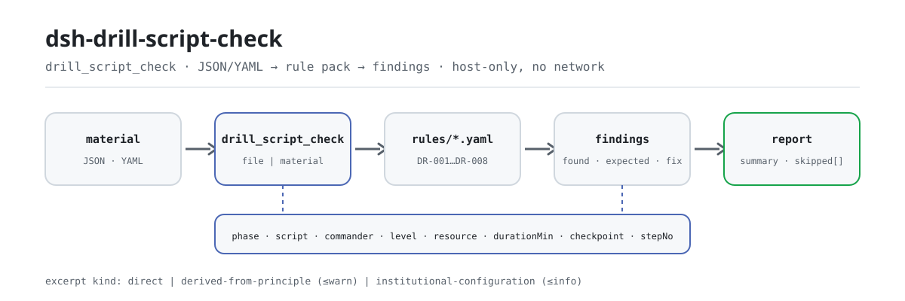

<div align="center">

<picture>
  <source media="(prefers-color-scheme: dark)" srcset="docs/assets/dsh-drill-script-check-flow-dark.svg">
  
</picture>

# dsh-drill-script-check

**एक आपातकालीन अभ्यास स्क्रिप्ट को अंतरों की सूची में बदलें — कौन-सी पंक्ति, कौन-सा कॉलम, क्या कम है और कैसे ठीक करें।**

सुरक्षा प्रबंधकों और आपातकालीन प्रबंधन कर्मियों के लिए DeepSeek Harness जाँच प्लगइन: अभ्यास हेडर और हर चरण की एक पंक्ति पढ़कर स्क्रिप्ट की पूर्णता और अंकगणित की जाँच करता है। यह केवल उन अंतरों को सूचीबद्ध करता है जिन्हें सामग्री के भीतर इंगित किया जा सकता है — अनुपालन का निर्णय नहीं, दायित्व का निर्धारण नहीं।

[इंस्टॉल](#तीन-चरणों-में-शुरुआत) · [कॉन्फ़िगरेशन](#कॉन्फ़िगरेशन) · [FAQ](#faq) · [简体中文](README.md) · [English](README.en.md) · [Español](README.es.md) · [Português](README.pt.md) · [हिन्दी](README.hi.md)

[](LICENSE)
[](#संगतता)
[](https://www.npmjs.com/package/dsh-drill-script-check)
[](https://github.com/PerryLink/dsh-drill-script-check/actions/workflows/ci.yml)
[](#संगतता)

[](https://github.com/PerryLink/dsh-drill-script-check/stargazers)
[](https://www.npmjs.com/package/dsh-drill-script-check)
[](https://dshfind.com/plugins/PerryLink/dsh-drill-script-check?ref=badge)
[](https://securityscorecards.dev/viewer/?uri=github.com/PerryLink/dsh-drill-script-check)
[](https://dsh.market/)
[](https://gitee.com/perrylink/dsh-drill-script-check)

```sh
dsh plugin --profile <name> add dsh-drill-script-check
```

</div>

<sub>सामुदायिक प्लगइन, DeepSeek से असंबद्ध। कैनोनिकल रिपॉज़िटरी: <https://github.com/PerryLink/dsh-drill-script-check> (Gitee एक मिरर है)।</sub>

## यह क्या है

`dsh-drill-script-check` एक आपातकालीन अभ्यास स्क्रिप्ट पढ़ता है — अभ्यास हेडर और हर चरण की एक पंक्ति — और उसी स्क्रिप्ट की पूर्णता तथा अंकगणित की जाँच करता है: क्या हर चरण अपना अभ्यास चरण या स्क्रिप्ट सामग्री दर्ज करता है, क्या कमांडर का नाम देता है, क्या प्रतिक्रिया स्तर आपके कॉन्फ़िगर किए शब्दावली से आता है, क्या स्क्रिप्ट क्रिया वाला चरण आवश्यक संसाधन सूचीबद्ध करता है, क्या चरणों की अवधि अभ्यास की नियोजित अवधि के बराबर है, क्या मुख्य चौकी अपनी निर्णय-शर्त बताती है, क्या कोई चरण संख्या दोहराई नहीं गई, और क्या हेडर अभ्यास तथा आयोजक संस्था का नाम देता है। यह «कौन-सी पंक्ति, कौन-सा कॉलम, क्या कम है और कैसे ठीक करें» की सूची लौटाता है: हर अंतर में `ruleId`, `locator` (पंक्ति और फ़ील्ड), `found`, `expected` और `fix` होते हैं। खाली सूची का अर्थ «सब सही» नहीं है — जो जाँच नहीं चल सकी, वह कारण सहित `skipped` में दर्ज होती है।

एक मिनट का परीक्षण (रेपो में शामिल नमूना, इंस्टॉल की ज़रूरत नहीं):

```sh
node samples/quickstart/run.mjs
```

```text
drill_script_check: 1 issue(s) — error 0, warn 1, info 0
skipped: 2
```

यह `samples/quickstart/input/DR-001-unsafe.json` के लिए वास्तविक आउटपुट है; अपेक्षित मान `samples/quickstart/expected/result.json` में है।

## तीन चरणों में शुरुआत

1. **इंस्टॉल करें** (एक चैनल चुनें):

   ```sh
   # git चैनल (नवीनतम main)
   dsh plugin --profile web add github:PerryLink/dsh-drill-script-check
   # npm चैनल (प्रकाशित संस्करण)
   dsh plugin --profile web add dsh-drill-script-check
   # tarball चैनल: इस रेपो में pnpm pack करके
   dsh plugin --profile web add ./dsh-drill-script-check-<version>.tgz
   ```

   प्रकाशित पैकेज में बिल्ड आर्टिफ़ैक्ट `lib/` पहले से है, इसलिए इंस्टॉल पर ही काम करता है; git चैनल से इंस्टॉल करने पर `prepare` इसे बनाता है।

2. **न्यूनतम कॉन्फ़िग** (bundle रूप एक पंक्ति जोड़ता है; कोई कुंजी आवश्यक नहीं):

   ```yaml
   - insert:
       - id: dsh-drill-script-check
         name: dsh-drill-script-check
   ```

   यही पंक्ति `package.json#dsh.bundle.patch` द्वारा संदर्भित `cordis.patch.yml` है; किसी भी सेटिंग के लिए इसके नीचे `config` ब्लॉक जोड़ें।

3. **माउंट सत्यापित करें**:

   ```sh
   dsh --profile web --dump-config | grep 'dsh-drill-script-check'
   node samples/quickstart/run.mjs --json
   ```

   ```json
   {
     "tool": "drill_script_check",
     "issueCount": 1,
     "summary": {
       "error": 0,
       "warn": 1,
       "info": 0
     },
     "skippedCount": 2
   }
   ```

**अनइंस्टॉल**: `dsh plugin --profile web remove dsh-drill-script-check` (या प्रोफ़ाइल पैच से वह पंक्ति हटाएँ)।

## मुख्य क्षमताएँ

नियम डेटा कोड से अलग है: `rules/drill-script-check.yaml` हर जाँच घोषित करता है, और उस फ़ाइल को बदलने से TypeScript छुए बिना नियम-सेट संस्करण बदल जाता है। लोड के समय हर नियम के `document` / `number` / `clause` / `excerpt` / `kind` / `source` की जाँच होती है; अपना आधार बढ़ा-चढ़ाकर बताने वाला पैक लोड पर ही विफल होता है, भरोसेमंद दिखने वाली रिपोर्ट नहीं बनाता।

| नियम | क्या जाँचता है | स्तर | आधार प्रकार |
|---|---|---|---|
| `DR-001` | अभ्यास चरण या स्क्रिप्ट सामग्री में से कम से कम एक भरा हो | warn | सिद्धांत से व्युत्पन्न |
| `DR-002` | हर चरण कमांडर का नाम दे | warn | सिद्धांत से व्युत्पन्न |
| `DR-003` | प्रतिक्रिया स्तर आपकी कॉन्फ़िगर की सूची से हो (डिफ़ॉल्ट रूप से बंद) | info | संस्थागत कॉन्फ़िगरेशन |
| `DR-004` | स्क्रिप्ट क्रिया वाला चरण आवश्यक संसाधन सूचीबद्ध करे | warn | सिद्धांत से व्युत्पन्न |
| `DR-005` | चरणों की अवधि का योग नियोजित अवधि के बराबर हो | warn | सिद्धांत से व्युत्पन्न |
| `DR-006` | मुख्य चौकी अपनी निर्णय-शर्त लिखे | warn | सिद्धांत से व्युत्पन्न |
| `DR-007` | स्क्रिप्ट में चरण संख्याएँ अद्वितीय हों | warn | सिद्धांत से व्युत्पन्न |
| `DR-008` | हेडर अभ्यास और आयोजक संस्था का नाम दे | warn | सिद्धांत से व्युत्पन्न |

### सामग्री प्रारूप

JSON या YAML स्वीकार्य। कॉलम नाम बड़े/छोटे अक्षर, स्पेस, अंडरस्कोर और हाइफ़न की उपेक्षा के साथ मिलाए जाते हैं; स्क्रिप्ट के अपने कॉलम नाम सुरक्षित रहते हैं, इसलिए हर अंतर आपके लिखे कॉलम की ओर इंगित करता है।

```yaml
drillName: 某某装置泄漏事故应急演练
drillType: 综合演练
organizer: 某某公司应急管理部
plannedAt: 2026-06-10
totalDurationMin: '15'
rows:
  - { 序号: '1', 演练阶段: 预警与信息报告,
      脚本内容: 值班员发现泄漏报警，电话报告应急指挥部,
      指挥人: 张指挥, 参演人员: 值班员、调度员,
      所需资源: 对讲机 4 台、气体检测仪 2 台, 计划时长: '15',
      响应级别: Ⅲ级, 关键节点: 指挥部确认接报并启动响应（判定条件：指挥人下达启动指令） }
```

### उदाहरण

**टूल** `drill_script_check`

**इनपुट**

```json
{"rows":[{"序号":"1","演练阶段":"","脚本内容":"","指挥人":"张指挥", ...}]}
```

**आउटपुट**

```json
{
  "id": "dsh-drill-script-check.DR-001.de09b5a6",
  "ruleId": "DR-001",
  "severity": "warn",
  "locator": {
    "row": 1,
    "field": "phase"
  },
  "found": "पंक्ति 1 में phase और script दोनों खाली हैं",
  "expected": "phase और script में से कम से कम एक भरा होना चाहिए",
  "fix": "अभ्यास चरण और स्क्रिप्ट सामग्री भरें; यह नियम केवल भरा होना जाँचता है, क्रिया सही है या नहीं यह नहीं"
}
```

*Observed from `dsh-drill-script-check/tests/fixtures/DR-001/DR-001-unsafe.json; dsh-drill-script-check/tests/fixtures/DR-001/cases.json; dsh-drill-script-check/rules/drill-script-check.yaml; dsh-drill-script-check/tests/index.test.ts`*

### सामान्य प्रश्न

| आप पूछें | यह क्या उत्तर देता है |
|---|---|
| किसी चरण में अभ्यास चरण और स्क्रिप्ट सामग्री दोनों नहीं भरे। क्या यह सूचित होगा? | हाँ। `DR-001` `phase` और `script` दोनों कॉलम एक साथ माँगता है और उसी चरण को सूचित करता है जहाँ दोनों में से कोई नहीं भरा — एक भरना पर्याप्त है। यह केवल भरा होना जाँचता है, यह नहीं कि क्रिया सही है या आपकी आपातकालीन योजना से मेल खाती है। |
| मैंने प्रतिक्रिया स्तर भरा, पर `DR-003` `skipped` में दिखता है। क्यों? | `DR-003` `level` कॉलम की तुलना `values` की सूची से करता है, जो खाली आती है; जब तक आप अपने स्तर कॉन्फ़िगर नहीं करते, नियम चुपचाप पास होने के बजाय बताता है कि वह नहीं चल सका। यह केवल जाँचता है कि मान आपकी सूची में है — किसी घटना पर कौन-सा स्तर लगना चाहिए, यह कभी नहीं तय करता। |
| पूरी तरह सूचनात्मक चरण में उपकरण सूचीबद्ध नहीं हैं। क्या यह चिह्नित होगा? | नहीं। `DR-004` `resource` कॉलम केवल तब माँगता है जब उस चरण की `script` सामग्री भरी हो, इसलिए सूचनात्मक चरण से संसाधन नहीं माँगे जाते। यह जाँचता है कि संसाधन सूचीबद्ध हैं, यह नहीं कि वे पर्याप्त हैं या स्थल पर उपलब्धता से मेल खाते हैं। |
| चरणों की अवधि का योग अभ्यास की नियोजित अवधि के बराबर नहीं है। क्या यह पकड़ा जाएगा? | हाँ। `DR-005` चरणों के `durationMin` जोड़कर योग की तुलना `totalDurationMin` से करता है, जिसे वह सामग्री के हेडर से लेता है — पहले पंक्ति में खोजता है, फिर हेडर पर लौटता है। यह केवल जोड़ की जाँच है: समय का बँटवारा उचित या पर्याप्त है या नहीं, यह नहीं बताता। |
| किसी चरण के मुख्य चौकी कॉलम में क्या लिखना है? | `DR-006` उस चरण के `checkpoint` कॉलम में मुख्य नोड और उसकी निर्णय-शर्त भरा होना माँगता है। यह जाँचता है कि कुछ लिखा गया है, यह नहीं कि शर्त देखी जा सकती है या उपयुक्त है। |
| एक चरण तीन क्रिया-पंक्तियों में बँटा है और दो में एक ही चरण संख्या है। | `DR-007` दोहराई गई `stepNo` सूचित करता है, क्योंकि दोहराव अवधि-योग और चरण-गणना को अविश्वसनीय बनाता है। एक चरण को कई क्रिया-पंक्तियों में बाँटना सामान्य है — हर पंक्ति को अपनी संख्या दें। |

## कॉन्फ़िगरेशन

सभी सेटिंग `src/config.ts` के Schemastery फ़ील्ड हैं, जिन्हें कोड बदले बिना `cordis.yml` से बदला जा सकता है; प्रति-नियम सीमाएँ `rules/` के नियम पैक में रहती हैं।

| कुंजी | प्रकार | डिफ़ॉल्ट | विवरण |
|---|---|---|---|
| `rulesFile` | string | `rules/drill-script-check.yaml` | नियम पैक का पथ, पैकेज रूट के सापेक्ष |
| `disabledRules` | string[] | `[]` | जिन नियम आईडी को बंद करना है; हर एक `skipped` में दिखेगा |
| `onlyRules` | string[] | `[]` | केवल ये नियम आईडी चलाएँ; खाली का अर्थ सभी नियम |
| `skipNotes` | string | `""` | हर `skipped` कारण के साथ जोड़ा जाने वाला नोट, जैसे संस्था के कार्यान्वयन नियम |
| `timeoutMs` | number | `120000` | टूल का सहकारी टाइमआउट बजट |

जानने योग्य नियम-स्तरीय पैरामीटर:

- `DR-003` `values` — आपके प्रतिक्रिया स्तर, जैसे `[Ⅰ级, Ⅱ级, Ⅲ级, Ⅳ级]`। खाली का अर्थ कोई जाँच नहीं, और नियम `skipped` में दिखता है।
- `DR-005` `field` / `headerField` / `tolerance` — अवधि कॉलम, वह हेडर योग जिससे मिलना है, और सहनशीलता (डिफ़ॉल्ट `0.01`)।
- `DR-004` `conditionField` / `requiredFields` — संसाधन की माँग कब सक्रिय होती है और कौन-से कॉलम चाहिए।
- `DR-008` `fields` — हेडर में घोषित होने वाले फ़ील्ड, डिफ़ॉल्ट `[drillName, organizer]`।

प्रोफ़ाइल पैच में ओवरराइड का उदाहरण:

```yaml
- insert:
    - id: dsh-drill-script-check
      name: dsh-drill-script-check
      config:
        onlyRules: [DR-001, DR-004, DR-005, DR-007]
        skipNotes: संस्था के कार्यान्वयन नियम, 2026 संस्करण
```

## FAQ

<details>
<summary>सामग्री कहाँ जाती है? प्लगइन क्या पढ़ता और लिखता है?</summary>

यह केवल आपके दिए `file` (या इनलाइन `material`) को पढ़ता है; कोई फ़ाइल नहीं लिखता, कोई नेटवर्क अनुरोध नहीं करता और किसी मॉडल को नहीं बुलाता। रिपोर्ट `markdown` और `reportJson` के रूप में लौटती है। मैनिफ़ेस्ट का demo केवल «उपयोगकर्ता द्वारा दी गई सामग्री फ़ाइल» पढ़ना घोषित करता है, लिखना कुछ नहीं।

</details>

<details>
<summary>रिपोर्ट में कोई समस्या नहीं दिखी — क्या इसका अर्थ स्क्रिप्ट ठीक है?</summary>

नहीं। जो जाँच नहीं चल सकी, वह कारण सहित `skipped` में सूचीबद्ध होती है; उदाहरण के लिए `DR-003` खाली `values` के साथ आता है और स्तर कॉन्फ़िगर करने तक चुपचाप पास होने के बजाय `skipped` बताता है। खाली समस्या-सूची का अर्थ केवल यह है कि «जो जाँचें चलीं, उन्हें कोई अंतर नहीं मिला»।

</details>

<details>
<summary>`DR-005` कहता है अवधि नहीं मिलती, पर मुझे ठीक लगती है?</summary>

यह पंक्तियों के `durationMin` जोड़कर योग की तुलना हेडर के `totalDurationMin` से करता है, `0.01` सहनशीलता के साथ। सामान्य कारण हैं कोई चरण-पंक्ति छूट जाना या कोई अवधि गलत लिखी जाना। यह केवल जोड़ की जाँच है: समय का बँटवारा उचित या पर्याप्त है या नहीं, यह नहीं बताता।

</details>

<details>
<summary>क्या यह अन्य प्लगइनों से टूल नाम, सर्विस कुंजी या इवेंट के लिए टकराता है?</summary>

नहीं। यह नामस्थान वाला एक ही टूल `drill_script_check` पंजीकृत करता है; कोई सर्विस कुंजी नहीं देता, कोई क्लाइंट slot नहीं और कोई `webServer` रूट नहीं पंजीकृत करता, और कोई साझा इवेंट नहीं सुनता। bundle पैच केवल अपनी पंक्ति `insert` करता है। बिंदु-दर-बिंदु तर्क «अन्य DSH प्लगइनों के साथ इंटरऑपरेबिलिटी» में है।

</details>

<details>
<summary>प्रदर्शन पर कितना भार है?</summary>

पूरी तरह स्थानीय तालिका-गणित: कोई नेटवर्क अनुरोध नहीं, कोई मॉडल कॉल नहीं, कोई नेटिव निर्भरता नहीं। `timeoutMs` का डिफ़ॉल्ट `120000` ms सहकारी टाइमआउट बजट है; यह जाँच के तर्क को नहीं बदलता।

</details>

## सुरक्षा सीमाएँ और ज्ञात सीमाएँ

**सीमा:** यह प्लगइन एक **आपातकालीन अभ्यास स्क्रिप्ट** की पूर्णता और अंकगणित जाँचता है — क्या हर चरण अपना अभ्यास चरण और स्क्रिप्ट सामग्री लिखता है, क्या कमांडर का नाम देता है, क्या प्रतिक्रिया स्तर आपकी शब्दावली से आता है, क्या क्रिया वाला चरण आवश्यक संसाधन सूचीबद्ध करता है, क्या अवधियों का योग नियोजित अवधि के बराबर है, क्या मुख्य चौकियाँ अपनी निर्णय-शर्त बताती हैं, क्या चरण संख्याएँ अद्वितीय हैं, और क्या स्क्रिप्ट अभ्यास तथा आयोजक का नाम देती है। यह **नहीं** तय करता कि अभ्यास यथार्थवादी या प्रभावी था, प्रतिक्रिया स्तर सही था, क्रियाएँ सही थीं, या अभ्यास अपने उद्देश्यों तक पहुँचा।

- **अनुपालन या दायित्व का निर्णय नहीं।** केवल वे अंतर गिनाता है जिन्हें सामग्री के भीतर इंगित किया जा सकता है; निष्कर्ष समीक्षक का है।
- **अनुच्छेद का पाठ इस बार नहीं मिला।** YJ/T 9007—2019 के शब्दशः अनुच्छेद नहीं मिले; हर नियम का `excerpt` यह बताता है और उसका `kind` `derived-from-principle` (स्तर अधिकतम `warn`) या `institutional-configuration` (अधिकतम `info`) है। पाठ मिलने पर `excerpt` को वास्तविक अनुच्छेद से बदलें और `kind` को `direct` तक बढ़ाएँ।
- **प्रतिक्रिया स्तर अंतर्निहित नहीं।** `DR-003` खाली `values` के साथ आता है; इसे अपनी आपातकालीन योजनाओं के पैमाने से भरें। प्लगइन केवल जाँचता है कि मान आपकी सूची में है — किसी घटना पर कौन-सा स्तर लगना चाहिए, यह कभी नहीं तय करता।
- **कॉलम मिलान उदार है।** फ़ील्ड नाम बड़े/छोटे अक्षर, स्पेस, अंडरस्कोर और हाइफ़न की उपेक्षा करते हैं; रिपोर्ट स्क्रिप्ट के अपने कॉलम नाम रखती है, इसलिए अंतर आपके हेडर की ओर इंगित करता है।
- **`DR-005` को हेडर योग चाहिए।** हेडर में `totalDurationMin` न हो, या किसी चरण में अवधि दर्ज न हो, तो नियम `skipped` में दिखता है।
- **`check` `manifest-peers` को विफल बता सकता है।** स्थिर जाँच 0.2 पंक्ति से पहले के हार्डकोडेड peer रेंज से तुलना करती है; रनटाइम इंस्टॉल पर peer अनुकूलता लागू करता है, इसलिए घोषित रेंज सही है। यह `dsh-plugin-dev` की ज्ञात अपस्ट्रीम समस्या है।

### समस्या-निवारण

- **प्लगइन इंस्टॉल हो गया पर टूल नहीं दिखता।** जाँचें कि `main` `lib/index.mjs` की ओर जाता है और `pnpm run build` ने उसे बनाया है; गलत `main` पर लोडर उस प्रविष्टि को चुपचाप छोड़ देता है।
- **`dsh plugin add` पैकेज को असंगत बताकर अस्वीकार करता है।** peer रेंज `0.1.x` और `0.2.x` को कवर करती है; यदि आपका रनटाइम उसके बाहर है, तो स्पष्ट छूट दें: `dsh plugin --profile <name> allow-version dsh-drill-script-check@0.1.0 --dsh-version <runtime> --accept-risk`।
- **कोई नियम नहीं चला।** `skipped` array देखें; उसमें नियम id और कारण लिखा है।
- **समय खिसका हुआ लगता है।** सभी गणनाएँ इनपुट स्ट्रिंग पर वॉल-क्लॉक अंकगणित हैं; कोई टाइम-ज़ोन रूपांतरण नहीं होता।

### अन्य DSH प्लगइनों के साथ इंटरऑपरेबिलिटी

- **टूल नाम का टकराव नहीं।** यह ठीक एक नामस्थान वाला टूल `drill_script_check` पंजीकृत करता है; किसी अंतर्निहित टूल या अन्य प्लगइन के नंगे नाम पर कब्ज़ा नहीं करता।
- **सर्विस कुंजी, slot या रूट का टकराव नहीं।** कोई सर्विस कुंजी नहीं देता, कोई क्लाइंट slot नहीं और कोई `webServer` प्रीफ़िक्स नहीं पंजीकृत करता।
- **साझा इवेंट श्रोता नहीं।** `agent/pre-step` या `tools/post-execute` जैसे क्रम-संवेदी इवेंट नहीं सुनता, इसलिए किसी श्रृंखला में भाग नहीं लेता और किसी दूसरे का परिणाम नहीं काटता।
- **पैच परत का टकराव नहीं।** bundle पैच केवल अपनी पंक्ति `insert` करता है; अंतर्निहित पंक्ति का `config` कभी नहीं बदलता।
- **वैश्विक परिवर्तन नहीं।** प्रोटोटाइप नहीं बदलता, `process.env` नहीं लिखता, वैश्विक fetch dispatcher नहीं बदलता।

## स्रोत और उद्धरण

| दस्तावेज़ | संख्या | इसे उद्धृत करने वाले नियम |
|---|---|---|
| उत्पादन सुरक्षा दुर्घटनाओं के आपातकालीन अभ्यासों की मूल विशिष्टि | YJ/T 9007—2019 (पूर्व में AQ/T 9007—2019, 2025 की अधिसूचना संख्या 1 से कोड बदला; इस बार अनुच्छेद का पाठ नहीं मिला) | DR-001, DR-002, DR-004, DR-005, DR-006, DR-007, DR-008 |
| इस संस्था की आपातकालीन योजना प्रणाली (स्थानीय कॉन्फ़िगरेशन) | कोई सामान्य मानक नहीं (यह नियम संस्था की अपनी प्रतिक्रिया-स्तर शब्दावली पर आधारित है) | DR-003 |

> ### रिपोर्ट के किसी उद्धरण पर भरोसा करने से पहले यह पढ़ें
>
> **`excerpt` की स्थिति हर नियम में अलग है, एकसमान नहीं।** कुछ नियम अनुच्छेद शब्दशः उद्धृत करते हैं (`kind: direct`), कुछ उद्धृत अनुच्छेदों के सिद्धांत से व्युत्पन्न हैं (`kind: derived-from-principle`, अधिकतम `warn`), और कुछ ऐसी सीमाएँ उपयोग करते हैं जो आपकी संस्था कॉन्फ़िगर करती है (`kind: institutional-configuration`, अधिकतम `info`)। पैक कभी उद्धरण का पैराफ़्रेज़ नहीं करता: जब पाठ नहीं मिला, `excerpt` फ़ील्ड यह बताता है और तर्क `note` में रहता है; एक परीक्षण प्रमाणित करता है कि कोई नियम ऐसा उद्धरण नहीं दावा करता जो उसके पास नहीं है। **जो नियम अब भी «पाठ नहीं मिला» के रूप में चिह्नित हैं, उनके लिए पाठ मिलने पर `excerpt` को वास्तविक अनुच्छेद से बदलें और `kind` को `direct` तक बढ़ाएँ।**
>
> निष्कर्ष समीक्षक का है: यह प्लगइन सामग्री में इंगित करने योग्य अंतर गिनाता है और तथ्य या अनुपालन का निर्णय नहीं करता।

नियम डेटा `rules/drill-script-check.yaml` में है। पैक का हेडर उद्धरण-अंतराल पूरा बताता है, और हर नियम का `note` उस नियम से संबंधित भाग दोहराता है। लोड-समय की वह गार्ड जो सामान्यतः «excerpt कम से कम आठ अक्षरों का वास्तविक उद्धरण हो» लागू करती है, उद्धरण और विवरण में अंतर नहीं कर सकती — इसलिए यह पैक हेडर, प्रति-नियम नोट और उस परीक्षण पर टिका है जो प्रमाणित करता है कि हर `excerpt` अंतराल स्वीकार करता है।

## संगतता

| सतह | स्थिति |
|---|---|
| Harness | Peer रेंज `>=0.1.2-rc.1 <0.2.0 \|\| >=0.2.0-0 <0.3.0` — सत्यापित कि `0.2.0-rc.2` और `0.2.1-rc.2` दोनों स्वीकार्य। `engines.dsh` `>=0.2.1-0 <0.3.0` घोषित है और 0.2.1 से होस्ट इसे लागू करता है |
| Node | `^22.19.0 \|\| >=24.0.0` |
| प्लेटफ़ॉर्म | सभी (शुद्ध ESM; कोई नेटिव कोड नहीं, कोई नेटवर्क नहीं, कोई मॉडल कॉल नहीं) |
| टूल मोड | `native` और `ptc` दोनों में काम करता है; पूरी डायरेक्टरी के लिए `ptc` उपयुक्त है, schema लागत एक बार चुकाई जाती है |

## इकोसिस्टम और गुणवत्ता

- [Gitee मिरर](https://gitee.com/perrylink/dsh-drill-script-check) (सिंक मिरर; GitHub कैनोनिकल है)
- [dshfind प्लगइन पेज](https://dshfind.com/plugins/PerryLink/dsh-drill-script-check) (इंस्टॉल और रैंकिंग)
- [OpenSSF Scorecard रिपोर्ट](https://securityscorecards.dev/viewer/?uri=github.com/PerryLink/dsh-drill-script-check) ([.github/workflows/scorecard.yml](.github/workflows/scorecard.yml) द्वारा संचालित)
- [DSH Market](https://dsh.market/) (सूचीबद्ध)
- [इकोसिस्टम ज्ञानकोश](https://perrylink.github.io/dsh-plugin-guide/): प्लगइन विकास गाइड · चयन डेटा · रखरखाव मानदंड

## डेवलपमेंट

```sh
pnpm install
pnpm run typecheck                       # tsc --noEmit
pnpm test                                # vitest, साझा टेबल-प्लगइन सूट और युग्मित fixtures
pnpm run build                           # tsdown -> lib/index.mjs + lib/index.d.mts
pnpm run verify:self-contained           # निर्भरता spec रजिस्ट्री से हल होते हैं
pnpm run check:lockfile                  # lockfile विचलन
pnpm run check:readmes                   # README की Consistency
pnpm run check:citations                 # उद्धरण सत्यापन आधार
pnpm pack                                # प्रकाशित tarball
```

`prepublishOnly` पूरा गेट दोबारा चलाता है, इसलिए कोई रिलीज़ बिना बिल्ड या विचलित ट्री प्रकाशित नहीं कर सकती।

प्लगइन **केवल डेटा** है: `src/model.ts` तालिका का आकार और सामग्री अनुबंध घोषित करता है, साझा किट पाठक और जाँच इंजन देता है, और नियम पैक हर जाँच घोषित करता है। मौजूदा प्रकार में फ़िट होने वाली नई जाँच जोड़ना नियम पैक का संपादन है, कोड परिवर्तन नहीं।

| पथ | भूमिका |
|---|---|
| `src/index.ts` | फ़ंक्शन-प्लगइन अनुबंध (`name` / `inject` / `Config` / `apply`, कोई default export नहीं); `drill_script_check` टूल पंजीकृत करता है और नियम पैक का पथ हल करता है |
| `src/config.ts` | Schemastery schema; सभी सेटिंग यहीं |
| `src/model.ts` | तालिका का आकार और सामग्री अनुबंध: कॉलम-उपनाम मैप और कैनोनिकल-से-हेडर फ़ील्ड मैप |
| `src/view.ts` | रिपोर्ट का मॉडल-उन्मुख प्रक्षेपण; `output.schema` इसे प्रतिबिंबित करता है |
| `src/shared/` | साझा किट (पाठक, तालिका जाँच इंजन, नियम लोडर, रिपोर्ट आकार, YAML उपसमुच्चय, कैलेंडर गणना, शब्द-गार्ड, तालिका सहायक); कॉपी किया गया, आयात नहीं |
| `rules/drill-script-check.yaml` | नियम पैक, 8 नियम |
| `rules/evidence/` | पैक के हर उद्धरण का अनुच्छेद-सत्यापन रिकॉर्ड (`clause-verification-yj9007.md`) |
| `tests/` | vitest; हर नियम के लिए युग्मित अनुपालक/उल्लंघनकारी fixture, साथ में सीमा-अर्थ परीक्षण और साझा तालिका सूट |
| `samples/quickstart/` | एक मिनट का परीक्षण नमूना और अपेक्षित आउटपुट |
| `scripts/` | यांत्रिक गेट और README चित्र निर्माण |

README चित्र: `docs/assets/dsh-drill-script-check-flow-{light,dark}.svg` [`scripts/gen-readme-assets.py`](scripts/gen-readme-assets.py) से प्रोग्रामेटिक रूप से बनते हैं (Python + Pillow; CJK फ़ॉन्ट न मिलने पर स्क्रिप्ट तुरंत त्रुटि देकर रुकती है)। चित्र में केवल कमांड token हैं, इसलिए पाँचों भाषाएँ इसे साझा करती हैं:

```sh
python scripts/gen-readme-assets.py
```

इस रेपो में benchmark डेटा नहीं है, इसलिए evidence बार-चार्ट नहीं बनाया जाता।

## परिवार और आभार

यह परियोजना [PerryLink](https://github.com/PerryLink) द्वारा अनुरक्षित DeepSeek Harness प्लगइन परिवार का सदस्य है (सभी Apache-2.0)। अगर यह उपयोगी लगे, **एक star अगले व्यक्ति को इसे खोजने में मदद करता है** — इसके पीछे कोई सुविधा बंद नहीं है।

- [@PerryLink](https://github.com/PerryLink) — निर्माता और अनुरक्षक: नियम पैक और जाँच इंजन, तथा पाँच-भाषा दस्तावेज़।

<details>
<summary>सभी प्लगइन विस्तारित करें</summary>

| प्लगइन | स्थिति |
|---|---|
| **[dsh-aqua-input-check](https://github.com/PerryLink/dsh-aqua-input-check)** |  |
| **[dsh-archive-check](https://github.com/PerryLink/dsh-archive-check)** |  |
| **[dsh-auto-review](https://github.com/PerryLink/dsh-auto-review)** |  |
| **[dsh-autotier](https://github.com/PerryLink/dsh-autotier)** | 🧊 फ़्रोज़न — रेपो README देखें |
| **[dsh-bid-ca-precheck](https://github.com/PerryLink/dsh-bid-ca-precheck)** |  |
| **[dsh-bid-qual-check](https://github.com/PerryLink/dsh-bid-qual-check)** |  |
| **[dsh-cert-mcp](https://github.com/PerryLink/dsh-cert-mcp)** | 🧊 फ़्रोज़न — रेपो README देखें |
| **[dsh-checkpoint-rewind](https://github.com/PerryLink/dsh-checkpoint-rewind)** |  |
| **[dsh-click](https://github.com/PerryLink/dsh-click)** |  |
| **[dsh-composer-history](https://github.com/PerryLink/dsh-composer-history)** |  |
| **[dsh-contract-stance](https://github.com/PerryLink/dsh-contract-stance)** |  |
| **[dsh-customs-doc-check](https://github.com/PerryLink/dsh-customs-doc-check)** |  |
| **[dsh-data-quality](https://github.com/PerryLink/dsh-data-quality)** | 🧊 फ़्रोज़न — रेपो README देखें |
| **[dsh-demurrage-ledger](https://github.com/PerryLink/dsh-demurrage-ledger)** |  |
| **[dsh-doublecheck](https://github.com/PerryLink/dsh-doublecheck)** |  |
| **[dsh-drill-script-check](https://github.com/PerryLink/dsh-drill-script-check)** |  |
| **[dsh-eia-guide-check](https://github.com/PerryLink/dsh-eia-guide-check)** |  |
| **[dsh-emergency-plan](https://github.com/PerryLink/dsh-emergency-plan)** |  |
| **[dsh-essay-rubric-check](https://github.com/PerryLink/dsh-essay-rubric-check)** |  |
| **[dsh-evidence-check](https://github.com/PerryLink/dsh-evidence-check)** |  |
| **[dsh-export-ctl-check](https://github.com/PerryLink/dsh-export-ctl-check)** |  |
| **[dsh-fast](https://github.com/PerryLink/dsh-fast)** |  |
| **[dsh-fmea-table-check](https://github.com/PerryLink/dsh-fmea-table-check)** |  |
| **[dsh-forecast-penalty](https://github.com/PerryLink/dsh-forecast-penalty)** |  |
| **[dsh-fund-research](https://github.com/PerryLink/dsh-fund-research)** |  |
| **[dsh-github](https://github.com/PerryLink/dsh-github)** |  |
| **[dsh-gongwen-flow-check](https://github.com/PerryLink/dsh-gongwen-flow-check)** |  |
| **[dsh-gongwen-word-check](https://github.com/PerryLink/dsh-gongwen-word-check)** |  |
| **[dsh-guard-plan-qc](https://github.com/PerryLink/dsh-guard-plan-qc)** |  |
| **[dsh-hazchem-check](https://github.com/PerryLink/dsh-hazchem-check)** |  |
| **[dsh-hazplan-check](https://github.com/PerryLink/dsh-hazplan-check)** |  |
| **[dsh-hidden-risk-map](https://github.com/PerryLink/dsh-hidden-risk-map)** |  |
| **[dsh-hs-classify](https://github.com/PerryLink/dsh-hs-classify)** |  |
| **[dsh-icd-rule-check](https://github.com/PerryLink/dsh-icd-rule-check)** |  |
| **[dsh-industry-research](https://github.com/PerryLink/dsh-industry-research)** |  |
| **[dsh-lawcite-adapter](https://github.com/PerryLink/dsh-lawcite-adapter)** |  |
| **[dsh-laya](https://github.com/PerryLink/dsh-laya)** |  |
| **[dsh-lc-doc-check](https://github.com/PerryLink/dsh-lc-doc-check)** |  |
| **[dsh-learning-gap-check](https://github.com/PerryLink/dsh-learning-gap-check)** |  |
| **[dsh-library](https://github.com/PerryLink/dsh-library)** |  |
| **[dsh-local-ai](https://github.com/PerryLink/dsh-local-ai)** |  |
| **[dsh-lsp-actions](https://github.com/PerryLink/dsh-lsp-actions)** |  |
| **[dsh-mask](https://github.com/PerryLink/dsh-mask)** |  |
| **[dsh-mcp-panel](https://github.com/PerryLink/dsh-mcp-panel)** |  |
| **[dsh-medrec-qc](https://github.com/PerryLink/dsh-medrec-qc)** |  |
| **[dsh-memento](https://github.com/PerryLink/dsh-memento)** | 🧊 फ़्रोज़न — रेपो README देखें |
| **[dsh-nsfc-form-check](https://github.com/PerryLink/dsh-nsfc-form-check)** |  |
| **[dsh-nurse-record-check](https://github.com/PerryLink/dsh-nurse-record-check)** |  |
| **[dsh-observe](https://github.com/PerryLink/dsh-observe)** |  |
| **[dsh-origin-rvc-check](https://github.com/PerryLink/dsh-origin-rvc-check)** |  |
| **[dsh-ota-review-check](https://github.com/PerryLink/dsh-ota-review-check)** |  |
| **[dsh-output-styles](https://github.com/PerryLink/dsh-output-styles)** |  |
| **[dsh-paper-doc-adapter](https://github.com/PerryLink/dsh-paper-doc-adapter)** |  |
| **[dsh-permission-rules](https://github.com/PerryLink/dsh-permission-rules)** |  |
| **[dsh-permit-report-check](https://github.com/PerryLink/dsh-permit-report-check)** |  |
| **[dsh-pipeline-check](https://github.com/PerryLink/dsh-pipeline-check)** |  |
| **[dsh-pleading-draft](https://github.com/PerryLink/dsh-pleading-draft)** |  |
| **[dsh-plugin-doctor](https://github.com/PerryLink/dsh-plugin-doctor)** | 🚫 रिटायर्ड (रेपो संग्रहीत) |
| **[dsh-plugin-guide](https://github.com/PerryLink/dsh-plugin-guide)** |  |
| **[dsh-plugin-kit](https://github.com/PerryLink/dsh-plugin-kit)** | 🚫 रिटायर्ड (रेपो संग्रहीत) |
| **[dsh-plugin-upgrade](https://github.com/PerryLink/dsh-plugin-upgrade)** | 🚫 रिटायर्ड (रेपो संग्रहीत) |
| **[dsh-policy-brief-draft](https://github.com/PerryLink/dsh-policy-brief-draft)** |  |
| **[dsh-power-loss-split](https://github.com/PerryLink/dsh-power-loss-split)** |  |
| **[dsh-power-ticket-check](https://github.com/PerryLink/dsh-power-ticket-check)** |  |
| **[dsh-ppap-check](https://github.com/PerryLink/dsh-ppap-check)** |  |
| **[dsh-protest-deadline](https://github.com/PerryLink/dsh-protest-deadline)** |  |
| **[dsh-railway-window](https://github.com/PerryLink/dsh-railway-window)** |  |
| **[dsh-repair-order-qc](https://github.com/PerryLink/dsh-repair-order-qc)** |  |
| **[dsh-research-report](https://github.com/PerryLink/dsh-research-report)** |  |
| **[dsh-review-reply-check](https://github.com/PerryLink/dsh-review-reply-check)** |  |
| **[dsh-rulefile-check](https://github.com/PerryLink/dsh-rulefile-check)** |  |
| **[dsh-safety-brief-check](https://github.com/PerryLink/dsh-safety-brief-check)** |  |
| **[dsh-score](https://github.com/PerryLink/dsh-score)** | 🧊 फ़्रोज़न — रेपो README देखें |
| **[dsh-session-sync](https://github.com/PerryLink/dsh-session-sync)** |  |
| **[dsh-site-log-check](https://github.com/PerryLink/dsh-site-log-check)** |  |
| **[dsh-skill-pack-security](https://github.com/PerryLink/dsh-skill-pack-security)** |  |
| **[dsh-soe-decision-check](https://github.com/PerryLink/dsh-soe-decision-check)** |  |
| **[dsh-soilwater-check](https://github.com/PerryLink/dsh-soilwater-check)** |  |
| **[dsh-sop-sync-check](https://github.com/PerryLink/dsh-sop-sync-check)** |  |
| **[dsh-spc-gbt-adapter](https://github.com/PerryLink/dsh-spc-gbt-adapter)** |  |
| **[dsh-talk](https://github.com/PerryLink/dsh-talk)** |  |
| **[dsh-tender-extract](https://github.com/PerryLink/dsh-tender-extract)** |  |
| **[dsh-tender-matrix](https://github.com/PerryLink/dsh-tender-matrix)** |  |
| **[dsh-test-drive](https://github.com/PerryLink/dsh-test-drive)** |  |
| **[dsh-ticktick](https://github.com/PerryLink/dsh-ticktick)** | 🚫 रिटायर्ड (रेपो संग्रहीत) |
| **[dsh-translate](https://github.com/PerryLink/dsh-translate)** |  |
| **[dsh-warranty-calc](https://github.com/PerryLink/dsh-warranty-calc)** |  |
| **[dsh-budget](https://github.com/PerryLink/dsh-budget)** | 🧊 फ़्रोज़न — रेपो README देखें |
| **[dsh-claude-move](https://github.com/PerryLink/dsh-claude-move)** | 🧊 फ़्रोज़न — रेपो README देखें |
| **[dsh-defend](https://github.com/PerryLink/dsh-defend)** | 🧊 फ़्रोज़न — रेपो README देखें |
| **[dsh-draw](https://github.com/PerryLink/dsh-draw)** | 🧊 फ़्रोज़न — रेपो README देखें |
| **[dsh-reach](https://github.com/PerryLink/dsh-reach)** | 🧊 फ़्रोज़न — रेपो README देखें |
| **[dsh-background-agents](https://github.com/PerryLink/dsh-background-agents)** | 🚫 रिटायर्ड (रेपो संग्रहीत) |
| **[dsh-session-pin](https://github.com/PerryLink/dsh-session-pin)** | 🚫 रिटायर्ड (रेपो संग्रहीत) |
| **[dsh-team-rooms](https://github.com/PerryLink/dsh-team-rooms)** | 🚫 रिटायर्ड (रेपो संग्रहीत) |

</details>

## लाइसेंस

[LICENSE](LICENSE) (Apache License 2.0) © 2026 dsh-drill-script-check contributors

<p align="center"><sub>Apache-2.0 · सामुदायिक प्लगइन, DeepSeek से असंबद्ध।</sub></p>
