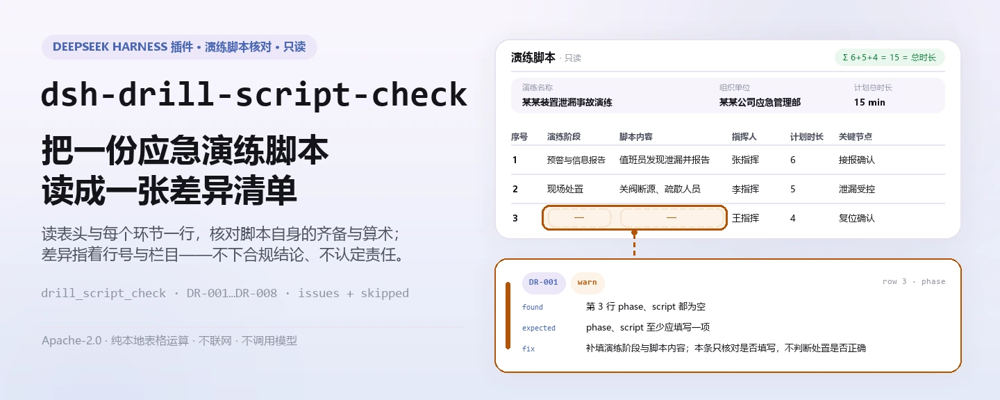
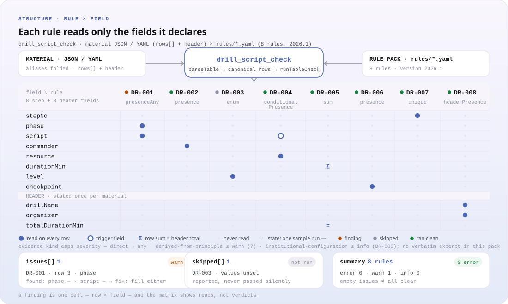

<div align="center">

<picture>
  <source media="(prefers-color-scheme: dark)" srcset="docs/assets/dsh-drill-script-check-hero-zh-dark.webp">
  
</picture>

# dsh-drill-script-check

**把一份应急演练脚本读成一张差异清单——哪一行、哪一栏、差什么、怎么补，逐条指认。**

面向安全管理员与应急管理岗的 DeepSeek Harness 核对插件：读演练表头加每个环节一行，核对脚本自身的齐备与算术；只列材料内部能指认的差异，不判合规、不认定责任。

[安装](#三步上手) · [配置](#配置) · [FAQ](#faq) · [简体中文](README.md) · [English](README.en.md)

[](LICENSE)
[](#兼容性)
[](https://www.npmjs.com/package/dsh-drill-script-check)
[](https://github.com/PerryLink/dsh-drill-script-check/actions/workflows/ci.yml)
[](#兼容性)

[](https://github.com/PerryLink/dsh-drill-script-check/stargazers)
[](https://www.npmjs.com/package/dsh-drill-script-check)
[](https://dshfind.com/plugins/PerryLink/dsh-drill-script-check?ref=badge)
[](https://securityscorecards.dev/viewer/?uri=github.com/PerryLink/dsh-drill-script-check)
[](https://dsh.market/)
[](https://gitee.com/perrylink/dsh-drill-script-check)

```sh
dsh plugin --profile <name> add dsh-drill-script-check
```

</div>

<sub>社区插件，与 DeepSeek 官方无关。唯一仓库：<https://github.com/PerryLink/dsh-drill-script-check>（Gitee 为镜像）。</sub>

## 它是什么

`dsh-drill-script-check` 读取一份应急演练脚本——演练表头加每个环节一行——核对这份脚本自身的齐备与算术：每个环节是否填写演练阶段或脚本内容、是否明确指挥人、响应级别是否取自你配置的口径、有脚本动作的环节是否列明所需资源、各环节计划时长合计是否等于演练总时长、关键节点是否写明判定条件、环节序号是否重复、表头是否声明演练名称与组织单位。它返回一份「哪一行、哪一栏、差什么、怎么补」的清单：每条发现都带 `ruleId`、`locator`（行与字段）、`found`、`expected`、`fix`。空清单不等于「全部正确」——无法执行的规则会逐条写进 `skipped` 并说明原因。

<picture>
  <source media="(prefers-color-scheme: dark)" srcset="docs/assets/dsh-drill-script-check-flow-v5-dark.svg">
  
</picture>

一分钟试跑（用仓内样例，不需要先安装）：

```sh
node samples/quickstart/run.mjs
```

```text
drill_script_check: 1 issue(s) — error 0, warn 1, info 0
skipped: 2
```

这是对 `samples/quickstart/input/DR-001-unsafe.json` 的真实输出，期望值见 `samples/quickstart/expected/result.json`。

## 三步上手

1. **安装**（三选一）：

   ```sh
   # git 通道（最新 main）
   dsh plugin --profile web add github:PerryLink/dsh-drill-script-check
   # npm 通道（已发布版本）
   dsh plugin --profile web add dsh-drill-script-check
   # tarball 通道：本仓库 pnpm pack 后
   dsh plugin --profile web add ./dsh-drill-script-check-<version>.tgz
   ```

   发布包自带构建产物 `lib/`，安装即用；从 git 通道安装时由 `prepare` 自动构建。

2. **最小配置**（bundle 形态自动插入一行，无需任何配置键）：

   ```yaml
   - insert:
       - id: dsh-drill-script-check
         name: dsh-drill-script-check
   ```

   `package.json#dsh.bundle.patch` 指向的 `cordis.patch.yml` 就是这一行；任何可调项都可以在这行下面加 `config`。

3. **验证已生效**：

   ```sh
   dsh --profile web --dump-config | grep 'dsh-drill-script-check'
   node samples/quickstart/run.mjs --json
   ```

   ```json
   {
     "tool": "drill_script_check",
     "issueCount": 1,
     "summary": {
       "error": 0,
       "warn": 1,
       "info": 0
     },
     "skippedCount": 2
   }
   ```

**卸载**：`dsh plugin --profile web remove dsh-drill-script-check`（或从 profile patch 删掉该行）。

## 核心能力

规则数据与代码分离：`rules/drill-script-check.yaml` 声明每条检查，替换该文件即可切换规则集版本，无需改 TypeScript。加载期逐条校验 `document` / `number` / `clause` / `excerpt` / `kind` / `source`，夸大依据的规则库会在加载期失败，而不是产出一份看起来很有底气的报告。

| 规则 | 核对什么 | 级别 | 依据类型 |
|---|---|---|---|
| `DR-001` | 演练阶段与脚本内容至少填写一项 | warn | 原则推导 |
| `DR-002` | 每个环节明确指挥人 | warn | 原则推导 |
| `DR-003` | 响应级别取自你配置的取值清单（默认不执行） | info | 本机构配置 |
| `DR-004` | 有脚本动作的环节列明所需资源 | warn | 原则推导 |
| `DR-005` | 各环节计划时长合计等于演练总时长 | warn | 原则推导 |
| `DR-006` | 关键节点写明判定条件 | warn | 原则推导 |
| `DR-007` | 环节序号在脚本内唯一 | warn | 原则推导 |
| `DR-008` | 表头声明演练名称与组织单位 | warn | 原则推导 |

### 材料格式

接受 JSON 或 YAML。字段名匹配忽略大小写、空格、下划线与连字符；报告沿用脚本自己的列名，因此每条发现都指回你表里的那一栏。

```yaml
drillName: 某某装置泄漏事故应急演练
drillType: 综合演练
organizer: 某某公司应急管理部
plannedAt: 2026-06-10
totalDurationMin: '15'
rows:
  - { 序号: '1', 演练阶段: 预警与信息报告,
      脚本内容: 值班员发现泄漏报警，电话报告应急指挥部,
      指挥人: 张指挥, 参演人员: 值班员、调度员,
      所需资源: 对讲机 4 台、气体检测仪 2 台, 计划时长: '15',
      响应级别: Ⅲ级, 关键节点: 指挥部确认接报并启动响应（判定条件：指挥人下达启动指令） }
```

### 示例

**工具** `drill_script_check`

**输入**

```json
{"rows":[{"序号":"1","演练阶段":"","脚本内容":"","指挥人":"张指挥", ...}]}
```

**输出**

```json
{
  "id": "dsh-drill-script-check.DR-001.de09b5a6",
  "ruleId": "DR-001",
  "severity": "warn",
  "locator": {
    "row": 1,
    "field": "phase"
  },
  "found": "第 1 行 phase、script 都为空",
  "expected": "phase、script 至少应填写一项",
  "fix": "补填演练阶段与脚本内容；本条只核对是否填写，不判断处置是否正确"
}
```

*Observed from `dsh-drill-script-check/tests/fixtures/DR-001/DR-001-unsafe.json; dsh-drill-script-check/tests/fixtures/DR-001/cases.json; dsh-drill-script-check/rules/drill-script-check.yaml; dsh-drill-script-check/tests/index.test.ts`*

### 典型问法

| 你会问 | 它怎么答 |
|---|---|
| 某个环节的演练阶段和脚本内容都没填，会被报出吗？ | 会。`DR-001` 同时要求 `phase` 与 `script` 两栏，两栏都空才报出该行——填了其中一栏即通过。它只核对这一栏是否填写，不判断该处置动作是否正确、是否符合预案。 |
| 我填了响应级别，`DR-003` 却报告 `skipped`，为什么？ | `DR-003` 拿 `level` 栏与 `values` 里的取值清单比对，而 `values` 出厂为空，因此在你配置本单位的分级口径之前，本条报告 `skipped`（无法执行），而不是静默通过。它只核对所填值是否在册，绝不判断某一事件应当启动哪一级响应。 |
| 纯告知性的环节没有列装备物资，会被报出吗？ | 不会。`DR-004` 只在环节的 `script` 内容已填写时才要求 `resource` 栏，因此纯告知性的环节不会被要求列资源。它只核对资源栏是否填写，不判断所列资源是否充足、是否与实际配备一致。 |
| 各环节计划时长加起来不等于演练总时长，能查出来吗？ | 能。`DR-005` 把各环节的 `durationMin` 相加，再与 `totalDurationMin` 相比，后者取自材料表头（引擎会先在行内找，再回落到表头）。本条只做加法核对，不判断时间安排是否合理、是否够用。 |
| 环节的关键节点栏要写什么？ | `DR-006` 要求该环节的 `checkpoint` 栏填写关键节点及其判定条件。它只核对这一栏是否写明，不判断该条件是否可观测、是否恰当。 |
| 同一阶段分了三个动作行，其中两行的环节序号相同。 | `DR-007` 会报出重复的 `stepNo`，因为序号重复会让时长合计与环节统计失真。同一阶段分多个动作各占一行是正常的——给每行各自的序号即可。 |

## 配置

全部可调参数都在 `src/config.ts` 的 Schemastery schema 中，只改 `cordis.yml` 即可生效，无需改代码；逐条阈值在 `rules/` 下的规则库文件里。

| 键 | 类型 | 默认值 | 说明 |
|---|---|---|---|
| `rulesFile` | string | `rules/drill-script-check.yaml` | 规则库文件路径，相对插件包根目录 |
| `disabledRules` | string[] | `[]` | 要停用的规则 id 列表；每条都会出现在 `skipped` 中 |
| `onlyRules` | string[] | `[]` | 只执行这些规则 id；留空表示执行全部规则 |
| `skipNotes` | string | `""` | 附加到每条 `skipped` 说明后的备注，例如标注本机构实施细则 |
| `timeoutMs` | number | `120000` | 工具协作式超时预算（毫秒） |

值得知道的规则级参数：

- `DR-003` 的 `values` —— 本单位的响应级别清单，例如 `[Ⅰ级, Ⅱ级, Ⅲ级, Ⅳ级]`；为空表示不检查，本条报 `skipped`。
- `DR-005` 的 `field` / `headerField` / `tolerance` —— 时长列、与它比对的总时长表头字段，以及容差（默认 `0.01`）。
- `DR-004` 的 `conditionField` / `requiredFields` —— 什么条件下要求资源栏，以及要求哪几栏。
- `DR-008` 的 `fields` —— 表头必须声明的字段，默认 `[drillName, organizer]`。

profile patch 覆盖示例：

```yaml
- insert:
    - id: dsh-drill-script-check
      name: dsh-drill-script-check
      config:
        onlyRules: [DR-001, DR-004, DR-005, DR-007]
        skipNotes: 本机构实施细则 2026 版
```

## FAQ

<details>
<summary>材料会传到哪？插件读写什么？</summary>

只读你给的 `file`（或内联 `material`），不写文件、不联网、不调用模型；报告以 `markdown` 与 `reportJson` 返回给你。manifest 的 demo 声明 reads 只有「用户指定的材料文件」，writes 为空。

</details>

<details>
<summary>报告里一条问题都没有，是不是就代表脚本没问题？</summary>

不是。无法执行的规则会逐条写进 `skipped` 并说明原因；例如 `DR-003` 的 `values` 出厂为空，在配置本级响应级别之前它报 `skipped`，而不是静默通过。空清单只表示「已执行的规则没有发现差异」。

</details>

<details>
<summary>`DR-005` 说时长对不上，但我看着没问题？</summary>

它把各行 `durationMin` 相加，与表头 `totalDurationMin` 比较，容差 `0.01`。常见原因是漏了一行环节，或某个时长打错。它只做加法核对，不判断时间安排是否合理、是否够用。

</details>

<details>
<summary>会和其他插件抢工具名、服务键或事件吗？</summary>

不会。只注册一个带命名空间的工具 `drill_script_check`，不提供服务键、不注册客户端 slot、不注册 `webServer` 路由、不监听共享事件；bundle patch 只 `insert` 自己一行。逐条论证见「与其他 DSH 插件的互操作性」。

</details>

<details>
<summary>性能开销多大？</summary>

纯本地表格运算：没有网络请求、没有模型调用、没有原生依赖。`timeoutMs` 默认 `120000` 毫秒是工具协作式超时预算，不改变检查逻辑。

</details>

## 安全边界与已知限制

**边界：** 本插件核对一份 **应急演练脚本** 的齐备性与算术——每个环节是否写明演练阶段与脚本内容，是否明确指挥人，响应级别是否取自你配置的取值口径，有脚本动作的环节是否列明所需资源，各环节计划时长合计是否等于演练总时长，关键节点是否写明判定条件，环节序号是否唯一，以及脚本是否写明演练名称与组织单位。它**不**判定演练是否逼真、是否有效，响应级别是否正确，处置动作是否正确，也不判定演练是否达到目标。

- **不判合规、不认定责任。** 只列材料内部能逐条指认的差异，结论性判断留给审核人。
- **引用原文本次未取得。** YJ/T 9007—2019 的逐字条文未取得；每条规则的 `excerpt` 如实写明这一点，`kind` 降为 `derived-from-principle`（严重级封顶 `warn`）或 `institutional-configuration`（封顶 `info`）。取得文本后应把 `excerpt` 换成真实条款，并把 `kind` 提升为 `direct`。
- **不内置响应分级。** `DR-003` 的 `values` 出厂为空，必须填本单位预案的分级口径；插件只核对所填值是否在册，绝不判断某一事件应当启动哪一级响应。
- **列名匹配是宽松的。** 字段名忽略大小写、空格、下划线与连字符；报告沿用脚本自己的列名，因此差异指回原表头。
- **`DR-005` 依赖表头总额。** 表头没有 `totalDurationMin`，或没有任何一步记录时长时，本条报 `skipped`。
- **`check` 的 `manifest-peers` 可能误报。** 静态检查器比对的是早于 0.2 世代的硬编码 peer 范围；安装期的 peer 校验以运行时为准，这是 `dsh-plugin-dev` 的已知上游问题。

### 排障

- **插件装上了但工具不出现。** 确认 `main` 指向 `lib/index.mjs` 且 `pnpm run build` 已生成该文件；`main` 写错会让加载器静默跳过该条目。
- **`dsh plugin add` 报版本不兼容。** peer 范围覆盖 `0.1.x` 与 `0.2.x`；若运行时在其之外，可显式豁免：`dsh plugin --profile <name> allow-version dsh-drill-script-check@0.1.0 --dsh-version <runtime> --accept-risk`。
- **某条规则没有执行。** 查看 `skipped` 数组，其中写明了规则 id 与原因。
- **时间看起来偏移。** 全部计算都是对输入字符串做墙上时钟运算，不做时区换算。

### 与其他 DSH 插件的互操作性

- **无工具名冲突。** 只注册 `drill_script_check` 一个工具，带插件命名空间，不占用内置工具或其他插件的裸名。
- **无服务键、slot、路由冲突。** 不提供任何服务键，不注册客户端 slot，不注册 `webServer` 前缀。
- **无共享事件监听。** 不监听 `agent/pre-step`、`tools/post-execute` 等顺序敏感事件，因此不参与任何链条，也不会短路别人的结果。
- **无 patch 层冲突。** bundle patch 只 `insert` 自己一行，不覆写内置行的 `config`。
- **无全局改写。** 不改原型、不改写 `process.env`、不替换全局 fetch dispatcher。

## 引用与依据

| 文件 | 文号 | 引用它的规则 |
|---|---|---|
| 《生产安全事故应急演练基本规范》 | YJ/T 9007—2019（原 AQ/T 9007—2019，2025 年第 1 号公告调整代号；本次未取得条文） | DR-001, DR-002, DR-004, DR-005, DR-006, DR-007, DR-008 |
| 本单位应急预案体系（本机构配置） | 无统一标准（本条依据为本机构预案的分级口径） | DR-003 |

> ### 采信报告里的引文之前，请先读这一段
>
> **每条 `excerpt` 的状态逐条不同，不是统一的。** 有的规则引用逐字条文（`kind: direct`），有的按条文原则推导（`kind: derived-from-principle`，最高 `warn`），有的阈值由本机构配置（`kind: institutional-configuration`，最高 `info`）。规则包从不概括引文：取不到原文时，`excerpt` 会如实写明，推理写在 `note` 里；并有测试断言没有任何规则声称拥有它并不拥有的引文。**对仍标为「未取得原文」的规则，取得文本后必须把 `excerpt` 换成真实条款，并把 `kind` 提升为 `direct`。**
>
> 结论性判断留给审核人：本插件只列出材料内部可以逐条指认的差异，不判断事实真伪，也不评价合规性。

规则数据在 `rules/drill-script-check.yaml`。规则包头部完整写明引用缺口，每条规则的 `note` 重复与该条相关的部分。加载期「摘录必须是真实引文且不少于八个字符」的守卫无法区分引文与描述，因此本包依赖头部说明、逐条 `note`，以及一条断言每条 `excerpt` 都承认缺口的测试。

## 兼容性

| 维度 | 状态 |
|---|---|
| Harness | 对等范围 `>=0.1.2-rc.1 <0.2.0 \|\| >=0.2.0-0 <0.3.0` —— 已实测同时接受 `0.2.0-rc.2` 与 `0.2.1-rc.2`。`engines.dsh` 声明为 `>=0.2.1-0 <0.3.0`，0.2.1 起由宿主单独裁决 |
| Node | `^22.19.0 \|\| >=24.0.0` |
| 平台 | 全平台（纯 ESM；无原生代码、无联网、不调用模型） |
| 工具模式 | `native` / `ptc` 均可；批量校验整个目录时建议 `ptc`，schema 成本只付一次 |

## 生态与质量

- [Gitee 镜像](https://gitee.com/perrylink/dsh-drill-script-check)（同步镜像，以 GitHub 为准）
- [dshfind 插件页](https://dshfind.com/plugins/PerryLink/dsh-drill-script-check)（安装量与排名）
- [OpenSSF Scorecard 报告](https://securityscorecards.dev/viewer/?uri=github.com/PerryLink/dsh-drill-script-check)（由 [.github/workflows/scorecard.yml](.github/workflows/scorecard.yml) 驱动）
- [DSH Market](https://dsh.market/)（已上架）
- [生态实测知识库](https://perrylink.github.io/dsh-plugin-guide/)：插件开发指南 · 选型实测数据 · 维护取舍判据

## 开发

```sh
pnpm install
pnpm run typecheck                       # tsc --noEmit
pnpm test                                # vitest，共享表格插件套件 + 成对夹具
pnpm run build                           # tsdown -> lib/index.mjs + lib/index.d.mts
pnpm run verify:self-contained           # 依赖 spec 均来自 registry
pnpm run check:lockfile                  # lockfile 漂移
pnpm run check:readmes                   # 五语 README 一致性
pnpm run check:citations                 # 引用核验基线
pnpm pack                                # 发布 tarball
```

`prepublishOnly` 会重跑整条门禁，因此发布不会带上未构建或已漂移的树。

插件是**数据驱动**的：`src/model.ts` 声明表格形状与材料契约，共享件提供读取器与检查引擎，规则包声明每条检查；新增一条同类型的检查只是规则包编辑，不是代码改动。

| 路径 | 作用 |
|---|---|
| `src/index.ts` | 函数插件契约（`name` / `inject` / `Config` / `apply`，无 default export）；注册 `drill_script_check` 工具并解析规则包路径 |
| `src/config.ts` | Schemastery schema；全部可调项都在这里 |
| `src/model.ts` | 表格形状与材料契约：声明可用列到规范字段名的映射，以及规范字段到表头字段的映射 |
| `src/view.ts` | 报告面向模型的投影；`output.schema` 镜像它 |
| `src/shared/` | 共享件（读取器、表格检查引擎、规则加载、报告形状、YAML 子集、日历运算、措辞守卫、表格助手）；复制进来而非依赖 |
| `rules/drill-script-check.yaml` | 规则包，8 条规则 |
| `rules/evidence/` | 每条引文的条款核验记录（`clause-verification-yj9007.md`） |
| `tests/` | vitest；每条规则一对合规/违规夹具，另有边界语义测试与共享表格套件 |
| `samples/quickstart/` | 一分钟试跑样例与期望输出 |
| `scripts/` | 门禁脚本与配图生成 |

配图复跑：`docs/assets/dsh-drill-script-check-hero-{zh,en}-{light,dark}.webp` 与 `docs/assets/dsh-drill-script-check-flow-v5-{light,dark}.svg` 均由 [`scripts/gen-readme-assets.py`](scripts/gen-readme-assets.py) 程序化生成（Pillow 画按语言本地化的 hero，手写 SVG 画规则×字段矩阵）；结构图只放命令面 token、规则/字段标识与简短英文注记，五语共用：

```sh
python scripts/gen-readme-assets.py
```

本仓没有 benchmark 数据，因此不生成 evidence 条形图。

## 家族与致谢

本项目是 [PerryLink](https://github.com/PerryLink) 维护的 DeepSeek Harness 插件家族成员（全部 Apache-2.0）。如果这个插件帮到了你，**给个 star**——它不解锁任何功能，但会让下一个人更容易找到它。

- [@PerryLink](https://github.com/PerryLink) —— 创建者与维护者：规则包与核对引擎、五语文档。

<details>
<summary>展开全部插件</summary>

| 插件 | 状态 |
|---|---|
| **[dsh-aqua-input-check](https://github.com/PerryLink/dsh-aqua-input-check)** |  |
| **[dsh-archive-check](https://github.com/PerryLink/dsh-archive-check)** |  |
| **[dsh-auto-review](https://github.com/PerryLink/dsh-auto-review)** |  |
| **[dsh-autotier](https://github.com/PerryLink/dsh-autotier)** | 🧊 已冻结 — 见仓库 README |
| **[dsh-bid-ca-precheck](https://github.com/PerryLink/dsh-bid-ca-precheck)** |  |
| **[dsh-bid-qual-check](https://github.com/PerryLink/dsh-bid-qual-check)** |  |
| **[dsh-cert-mcp](https://github.com/PerryLink/dsh-cert-mcp)** | 🧊 已冻结 — 见仓库 README |
| **[dsh-checkpoint-rewind](https://github.com/PerryLink/dsh-checkpoint-rewind)** |  |
| **[dsh-click](https://github.com/PerryLink/dsh-click)** |  |
| **[dsh-composer-history](https://github.com/PerryLink/dsh-composer-history)** |  |
| **[dsh-contract-stance](https://github.com/PerryLink/dsh-contract-stance)** |  |
| **[dsh-customs-doc-check](https://github.com/PerryLink/dsh-customs-doc-check)** |  |
| **[dsh-data-quality](https://github.com/PerryLink/dsh-data-quality)** | 🧊 已冻结 — 见仓库 README |
| **[dsh-demurrage-ledger](https://github.com/PerryLink/dsh-demurrage-ledger)** |  |
| **[dsh-doublecheck](https://github.com/PerryLink/dsh-doublecheck)** |  |
| **[dsh-drill-script-check](https://github.com/PerryLink/dsh-drill-script-check)** |  |
| **[dsh-eia-guide-check](https://github.com/PerryLink/dsh-eia-guide-check)** |  |
| **[dsh-emergency-plan](https://github.com/PerryLink/dsh-emergency-plan)** |  |
| **[dsh-essay-rubric-check](https://github.com/PerryLink/dsh-essay-rubric-check)** |  |
| **[dsh-evidence-check](https://github.com/PerryLink/dsh-evidence-check)** |  |
| **[dsh-export-ctl-check](https://github.com/PerryLink/dsh-export-ctl-check)** |  |
| **[dsh-fast](https://github.com/PerryLink/dsh-fast)** |  |
| **[dsh-fmea-table-check](https://github.com/PerryLink/dsh-fmea-table-check)** |  |
| **[dsh-forecast-penalty](https://github.com/PerryLink/dsh-forecast-penalty)** |  |
| **[dsh-fund-research](https://github.com/PerryLink/dsh-fund-research)** |  |
| **[dsh-github](https://github.com/PerryLink/dsh-github)** |  |
| **[dsh-gongwen-flow-check](https://github.com/PerryLink/dsh-gongwen-flow-check)** |  |
| **[dsh-gongwen-word-check](https://github.com/PerryLink/dsh-gongwen-word-check)** |  |
| **[dsh-guard-plan-qc](https://github.com/PerryLink/dsh-guard-plan-qc)** |  |
| **[dsh-hazchem-check](https://github.com/PerryLink/dsh-hazchem-check)** |  |
| **[dsh-hazplan-check](https://github.com/PerryLink/dsh-hazplan-check)** |  |
| **[dsh-hidden-risk-map](https://github.com/PerryLink/dsh-hidden-risk-map)** |  |
| **[dsh-hs-classify](https://github.com/PerryLink/dsh-hs-classify)** |  |
| **[dsh-icd-rule-check](https://github.com/PerryLink/dsh-icd-rule-check)** |  |
| **[dsh-industry-research](https://github.com/PerryLink/dsh-industry-research)** |  |
| **[dsh-lawcite-adapter](https://github.com/PerryLink/dsh-lawcite-adapter)** |  |
| **[dsh-laya](https://github.com/PerryLink/dsh-laya)** |  |
| **[dsh-lc-doc-check](https://github.com/PerryLink/dsh-lc-doc-check)** |  |
| **[dsh-learning-gap-check](https://github.com/PerryLink/dsh-learning-gap-check)** |  |
| **[dsh-library](https://github.com/PerryLink/dsh-library)** |  |
| **[dsh-local-ai](https://github.com/PerryLink/dsh-local-ai)** |  |
| **[dsh-lsp-actions](https://github.com/PerryLink/dsh-lsp-actions)** |  |
| **[dsh-mask](https://github.com/PerryLink/dsh-mask)** |  |
| **[dsh-mcp-panel](https://github.com/PerryLink/dsh-mcp-panel)** |  |
| **[dsh-medrec-qc](https://github.com/PerryLink/dsh-medrec-qc)** |  |
| **[dsh-memento](https://github.com/PerryLink/dsh-memento)** | 🧊 已冻结 — 见仓库 README |
| **[dsh-nsfc-form-check](https://github.com/PerryLink/dsh-nsfc-form-check)** |  |
| **[dsh-nurse-record-check](https://github.com/PerryLink/dsh-nurse-record-check)** |  |
| **[dsh-observe](https://github.com/PerryLink/dsh-observe)** |  |
| **[dsh-origin-rvc-check](https://github.com/PerryLink/dsh-origin-rvc-check)** |  |
| **[dsh-ota-review-check](https://github.com/PerryLink/dsh-ota-review-check)** |  |
| **[dsh-output-styles](https://github.com/PerryLink/dsh-output-styles)** |  |
| **[dsh-paper-doc-adapter](https://github.com/PerryLink/dsh-paper-doc-adapter)** |  |
| **[dsh-permission-rules](https://github.com/PerryLink/dsh-permission-rules)** |  |
| **[dsh-permit-report-check](https://github.com/PerryLink/dsh-permit-report-check)** |  |
| **[dsh-pipeline-check](https://github.com/PerryLink/dsh-pipeline-check)** |  |
| **[dsh-pleading-draft](https://github.com/PerryLink/dsh-pleading-draft)** |  |
| **[dsh-plugin-doctor](https://github.com/PerryLink/dsh-plugin-doctor)** | 🚫 已退役（仓库已归档） |
| **[dsh-plugin-guide](https://github.com/PerryLink/dsh-plugin-guide)** |  |
| **[dsh-plugin-kit](https://github.com/PerryLink/dsh-plugin-kit)** | 🚫 已退役（仓库已归档） |
| **[dsh-plugin-upgrade](https://github.com/PerryLink/dsh-plugin-upgrade)** | 🚫 已退役（仓库已归档） |
| **[dsh-policy-brief-draft](https://github.com/PerryLink/dsh-policy-brief-draft)** |  |
| **[dsh-power-loss-split](https://github.com/PerryLink/dsh-power-loss-split)** |  |
| **[dsh-power-ticket-check](https://github.com/PerryLink/dsh-power-ticket-check)** |  |
| **[dsh-ppap-check](https://github.com/PerryLink/dsh-ppap-check)** |  |
| **[dsh-protest-deadline](https://github.com/PerryLink/dsh-protest-deadline)** |  |
| **[dsh-railway-window](https://github.com/PerryLink/dsh-railway-window)** |  |
| **[dsh-repair-order-qc](https://github.com/PerryLink/dsh-repair-order-qc)** |  |
| **[dsh-research-report](https://github.com/PerryLink/dsh-research-report)** |  |
| **[dsh-review-reply-check](https://github.com/PerryLink/dsh-review-reply-check)** |  |
| **[dsh-rulefile-check](https://github.com/PerryLink/dsh-rulefile-check)** |  |
| **[dsh-safety-brief-check](https://github.com/PerryLink/dsh-safety-brief-check)** |  |
| **[dsh-score](https://github.com/PerryLink/dsh-score)** | 🧊 已冻结 — 见仓库 README |
| **[dsh-session-sync](https://github.com/PerryLink/dsh-session-sync)** |  |
| **[dsh-site-log-check](https://github.com/PerryLink/dsh-site-log-check)** |  |
| **[dsh-skill-pack-security](https://github.com/PerryLink/dsh-skill-pack-security)** |  |
| **[dsh-soe-decision-check](https://github.com/PerryLink/dsh-soe-decision-check)** |  |
| **[dsh-soilwater-check](https://github.com/PerryLink/dsh-soilwater-check)** |  |
| **[dsh-sop-sync-check](https://github.com/PerryLink/dsh-sop-sync-check)** |  |
| **[dsh-spc-gbt-adapter](https://github.com/PerryLink/dsh-spc-gbt-adapter)** |  |
| **[dsh-talk](https://github.com/PerryLink/dsh-talk)** |  |
| **[dsh-tender-extract](https://github.com/PerryLink/dsh-tender-extract)** |  |
| **[dsh-tender-matrix](https://github.com/PerryLink/dsh-tender-matrix)** |  |
| **[dsh-test-drive](https://github.com/PerryLink/dsh-test-drive)** |  |
| **[dsh-ticktick](https://github.com/PerryLink/dsh-ticktick)** | 🚫 已退役（仓库已归档） |
| **[dsh-translate](https://github.com/PerryLink/dsh-translate)** |  |
| **[dsh-warranty-calc](https://github.com/PerryLink/dsh-warranty-calc)** |  |
| **[dsh-budget](https://github.com/PerryLink/dsh-budget)** | 🧊 已冻结 — 见仓库 README |
| **[dsh-claude-move](https://github.com/PerryLink/dsh-claude-move)** | 🧊 已冻结 — 见仓库 README |
| **[dsh-defend](https://github.com/PerryLink/dsh-defend)** | 🧊 已冻结 — 见仓库 README |
| **[dsh-draw](https://github.com/PerryLink/dsh-draw)** | 🧊 已冻结 — 见仓库 README |
| **[dsh-reach](https://github.com/PerryLink/dsh-reach)** | 🧊 已冻结 — 见仓库 README |
| **[dsh-background-agents](https://github.com/PerryLink/dsh-background-agents)** | 🚫 已退役（仓库已归档） |
| **[dsh-session-pin](https://github.com/PerryLink/dsh-session-pin)** | 🚫 已退役（仓库已归档） |
| **[dsh-team-rooms](https://github.com/PerryLink/dsh-team-rooms)** | 🚫 已退役（仓库已归档） |

</details>

## License

[LICENSE](LICENSE)（Apache License 2.0）© 2026 dsh-drill-script-check contributors

<p align="center"><sub>Apache-2.0 · 社区插件，与 DeepSeek 无关。</sub></p>
