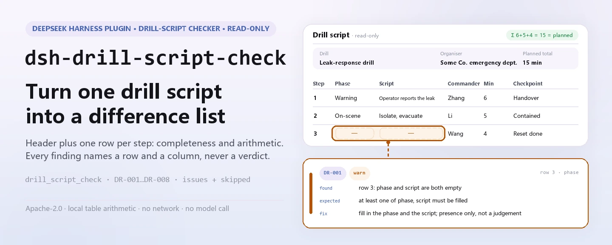

<div align="center">

<picture>
  <source media="(prefers-color-scheme: dark)" srcset="docs/assets/dsh-drill-script-check-hero-en-dark.webp">
  
</picture>

# dsh-drill-script-check

**Transforma um guião de simulacro de emergência numa lista de diferenças: que linha, que coluna, o que falta e como corrigir.**

Um verificador do DeepSeek Harness para responsáveis de segurança e de gestão de emergências: lê o cabeçalho do simulacro mais uma linha por etapa e verifica a completude e a aritmética do próprio guião. Lista apenas as diferenças que consegue apontar dentro do material: não emite veredicto de conformidade nem atribui responsabilidade.

[Instalar](#instalação-em-três-passos) · [Configuração](#configuração) · [FAQ](#faq) · [简体中文](README.md) · [English](README.en.md) · [Español](README.es.md) · [Português](README.pt.md) · [हिन्दी](README.hi.md)

[](LICENSE)
[](#compatibilidade)
[](https://www.npmjs.com/package/dsh-drill-script-check)
[](https://github.com/PerryLink/dsh-drill-script-check/actions/workflows/ci.yml)
[](#compatibilidade)

[](https://github.com/PerryLink/dsh-drill-script-check/stargazers)
[](https://www.npmjs.com/package/dsh-drill-script-check)
[](https://dshfind.com/plugins/PerryLink/dsh-drill-script-check?ref=badge)
[](https://securityscorecards.dev/viewer/?uri=github.com/PerryLink/dsh-drill-script-check)
[](https://dsh.market/)
[](https://gitee.com/perrylink/dsh-drill-script-check)

```sh
dsh plugin --profile <name> add dsh-drill-script-check
```

</div>

<sub>Plugin da comunidade, sem afiliação com a DeepSeek. Repositório canónico: <https://github.com/PerryLink/dsh-drill-script-check> (o Gitee é um espelho).</sub>

## O que é

O `dsh-drill-script-check` lê um guião de simulacro de emergência — o cabeçalho do simulacro mais uma linha por etapa — e verifica a completude e a aritmética desse guião: se cada etapa regista a sua fase de simulacro ou o seu conteúdo de guião, se nomeia um responsável de comando, se o nível de resposta vem do vocabulário que configura, se uma etapa com ação de guião enumera os recursos de que necessita, se as durações das etapas somam a duração prevista do simulacro, se um ponto crítico declara a sua condição de julgamento, se não há números de etapa repetidos e se o cabeçalho nomeia o simulacro e a entidade organizadora. Devolve uma lista de «que linha, que coluna, o que falta e como corrigir»: cada achado traz `ruleId`, `locator` (linha e campo), `found`, `expected` e `fix`. Uma lista vazia não significa «está tudo certo»: toda a verificação que não pôde correr é reportada em `skipped` com o motivo.

<picture>
  <source media="(prefers-color-scheme: dark)" srcset="docs/assets/dsh-drill-script-check-flow-v5-dark.svg">
  
</picture>

Teste de um minuto (usa a amostra incluída, sem instalar nada):

```sh
node samples/quickstart/run.mjs
```

```text
drill_script_check: 1 issue(s) — error 0, warn 1, info 0
skipped: 2
```

É a saída real para `samples/quickstart/input/DR-001-unsafe.json`; o valor esperado está em `samples/quickstart/expected/result.json`.

## Instalação em três passos

1. **Instale** (escolha um canal):

   ```sh
   # canal git (último main)
   dsh plugin --profile web add github:PerryLink/dsh-drill-script-check
   # canal npm (versões publicadas)
   dsh plugin --profile web add dsh-drill-script-check
   # canal tarball: pnpm pack neste repo e depois
   dsh plugin --profile web add ./dsh-drill-script-check-<version>.tgz
   ```

   O pacote publicado inclui o artefacto de compilação em `lib/`, por isso funciona ao instalar; uma instalação por git compila-o através de `prepare`.

2. **Configuração mínima** (a forma bundle insere uma linha; não exige nenhuma chave):

   ```yaml
   - insert:
       - id: dsh-drill-script-check
         name: dsh-drill-script-check
   ```

   Essa linha é o `cordis.patch.yml` referido por `package.json#dsh.bundle.patch`; acrescente um bloco `config` por baixo para qualquer ajuste.

3. **Verifique que monta**:

   ```sh
   dsh --profile web --dump-config | grep 'dsh-drill-script-check'
   node samples/quickstart/run.mjs --json
   ```

   ```json
   {
     "tool": "drill_script_check",
     "issueCount": 1,
     "summary": {
       "error": 0,
       "warn": 1,
       "info": 0
     },
     "skippedCount": 2
   }
   ```

**Desinstalar**: `dsh plugin --profile web remove dsh-drill-script-check` (ou remova a linha do patch de perfil).

## Capacidades principais

Os dados das regras estão separados do código: `rules/drill-script-check.yaml` declara cada verificação e substituir esse ficheiro muda a versão do conjunto de regras sem tocar em TypeScript. Cada regra é validada ao carregar em `document` / `number` / `clause` / `excerpt` / `kind` / `source`; um pacote que exagere o seu fundamento falha ao carregar em vez de produzir um relatório com aparência sólida.

| Regra | O que verifica | Nível | Tipo de fundamento |
|---|---|---|---|
| `DR-001` | a fase de simulacro ou o conteúdo de guião está preenchido | warn | derivado de princípio |
| `DR-002` | cada etapa nomeia um responsável de comando | warn | derivado de princípio |
| `DR-003` | o nível de resposta vem do vocabulário configurado (desligado por padrão) | info | configuração institucional |
| `DR-004` | uma etapa com ação de guião enumera os seus recursos | warn | derivado de princípio |
| `DR-005` | as durações das etapas somam a duração prevista | warn | derivado de princípio |
| `DR-006` | um ponto crítico declara a sua condição de julgamento | warn | derivado de princípio |
| `DR-007` | os números de etapa são únicos no guião | warn | derivado de princípio |
| `DR-008` | o cabeçalho nomeia o simulacro e a entidade organizadora | warn | derivado de princípio |

### Formato do material

Aceita JSON ou YAML. Os nomes de coluna são comparados sem distinguir maiúsculas e ignorando espaços, sublinhados e hífenes; os nomes de coluna do guião são mantidos, por isso cada achado aponta para a coluna que escreveu.

```yaml
drillName: 某某装置泄漏事故应急演练
drillType: 综合演练
organizer: 某某公司应急管理部
plannedAt: 2026-06-10
totalDurationMin: '15'
rows:
  - { 序号: '1', 演练阶段: 预警与信息报告,
      脚本内容: 值班员发现泄漏报警，电话报告应急指挥部,
      指挥人: 张指挥, 参演人员: 值班员、调度员,
      所需资源: 对讲机 4 台、气体检测仪 2 台, 计划时长: '15',
      响应级别: Ⅲ级, 关键节点: 指挥部确认接报并启动响应（判定条件：指挥人下达启动指令） }
```

### Exemplos

**Ferramenta** `drill_script_check`

**Entrada**

```json
{"rows":[{"序号":"1","演练阶段":"","脚本内容":"","指挥人":"张指挥", ...}]}
```

**Saída**

```json
{
  "id": "dsh-drill-script-check.DR-001.de09b5a6",
  "ruleId": "DR-001",
  "severity": "warn",
  "locator": {
    "row": 1,
    "field": "phase"
  },
  "found": "a linha 1 tem phase e script vazios",
  "expected": "pelo menos um de phase e script deve ser preenchido",
  "fix": "preencha a fase de simulacro e o conteúdo de guião; esta regra só verifica o preenchimento, não se a ação está correta"
}
```

*Observed from `dsh-drill-script-check/tests/fixtures/DR-001/DR-001-unsafe.json; dsh-drill-script-check/tests/fixtures/DR-001/cases.json; dsh-drill-script-check/rules/drill-script-check.yaml; dsh-drill-script-check/tests/index.test.ts`*

### Perguntas típicas

| Pergunta | O que responde |
|---|---|
| Uma etapa não tem fase de simulacro nem conteúdo de guião. É reportada? | Sim. `DR-001` pede as colunas `phase` e `script` em conjunto e reporta a etapa em que nenhuma das duas está preenchida — basta uma. Verifica se a coluna está preenchida, não se a ação está correta ou corresponde ao seu plano de emergência. |
| Preenchi o nível de resposta, mas `DR-003` aparece em `skipped`. Porquê? | `DR-003` compara a coluna `level` com o vocabulário em `values`, que vem vazio; até configurar os seus próprios níveis, a regra reporta que não pôde correr em vez de passar em silêncio. Só verifica se o valor está na sua lista — nunca julga que nível um evento deveria acionar. |
| Uma etapa meramente informativa não enumera equipamentos. É marcada? | Não. `DR-004` pede a coluna `resource` apenas quando o conteúdo `script` dessa etapa está preenchido, por isso uma etapa informativa não é obrigada a enumerar recursos. Verifica se os recursos estão enumerados, não se são suficientes ou se correspondem ao que existe no local. |
| As durações das etapas não somam a duração prevista do simulacro. É detetado? | Sim. `DR-005` soma os valores `durationMin` das etapas e compara o total com `totalDurationMin`, que tira do cabeçalho do material — procura primeiro na linha e recorre ao cabeçalho. É apenas uma verificação aritmética: não julga se a distribuição do tempo é razoável ou suficiente. |
| O que deve conter a coluna de ponto crítico de uma etapa? | `DR-006` exige que a coluna `checkpoint` — o nó crítico com a sua condição de julgamento — esteja preenchida na etapa. Verifica se algo foi escrito, não se a condição é observável ou adequada. |
| Uma fase está dividida em três linhas de ação e duas levam o mesmo número de etapa. | `DR-007` reporta o `stepNo` repetido, porque uma repetição torna o total de duração e a contagem de etapas pouco fiáveis. Dividir uma fase em várias linhas de ação é normal — dê a cada linha o seu próprio número. |

## Configuração

Todos os ajustes são campos Schemastery de `src/config.ts`, alteráveis a partir de `cordis.yml` sem tocar em código; os limiares por regra vivem no pacote de regras em `rules/`.

| Chave | Tipo | Valor por omissão | Descrição |
|---|---|---|---|
| `rulesFile` | string | `rules/drill-script-check.yaml` | Caminho do pacote de regras, relativo à raiz do pacote |
| `disabledRules` | string[] | `[]` | Ids de regras que deixam de correr; cada uma aparece em `skipped` |
| `onlyRules` | string[] | `[]` | Correr apenas estes ids; vazio corre todas as regras |
| `skipNotes` | string | `""` | Nota acrescentada a cada motivo de `skipped`, p. ex. as normas de aplicação da instituição |
| `timeoutMs` | number | `120000` | Orçamento de tempo de espera cooperativo da ferramenta |

Parâmetros por regra que vale a pena conhecer:

- `DR-003` `values` — os seus níveis de resposta, p. ex. `[Ⅰ级, Ⅱ级, Ⅲ级, Ⅳ级]`. Vazio significa sem verificação, e a regra reporta-se em `skipped`.
- `DR-005` `field` / `headerField` / `tolerance` — a coluna de duração, o total de cabeçalho com que deve coincidir e a tolerância (por omissão `0.01`).
- `DR-004` `conditionField` / `requiredFields` — o que aciona a exigência de recursos e que colunas exige.
- `DR-008` `fields` — os campos de cabeçalho que devem ser declarados, `[drillName, organizer]` por omissão.

Exemplo de substituição no patch do perfil:

```yaml
- insert:
    - id: dsh-drill-script-check
      name: dsh-drill-script-check
      config:
        onlyRules: [DR-001, DR-004, DR-005, DR-007]
        skipNotes: normas de aplicação da instituição, edição 2026
```

## FAQ

<details>
<summary>Para onde vai o material? O que o plugin lê e escreve?</summary>

Lê apenas o `file` que indica (ou o `material` em linha); não escreve ficheiros, não faz pedidos de rede e não chama nenhum modelo. O relatório volta como `markdown` e `reportJson`. O demo do manifesto declara apenas a leitura de «o ficheiro de material que o utilizador indica» e nenhuma escrita.

</details>

<details>
<summary>O relatório não mostra qualquer problema. Isso significa que o guião está bem?</summary>

Não. Toda a verificação que não pôde correr é enumerada em `skipped` com o motivo; `DR-003`, por exemplo, vem com `values` vazio e reporta `skipped` até configurar os seus níveis, em vez de passar em silêncio. Uma lista de problemas vazia significa apenas que «as verificações executadas não encontraram diferenças».

</details>

<details>
<summary>`DR-005` diz que as durações não batem certo, mas parecem-me bem.</summary>

Soma as células `durationMin` e compara o total com o `totalDurationMin` do cabeçalho, com tolerância de `0.01`. As causas habituais são uma linha de etapa em falta ou um número mal escrito. É apenas uma verificação aritmética: não julga se a distribuição do tempo é razoável ou suficiente.

</details>

<details>
<summary>Compete com outros plugins por nomes de ferramenta, chaves de serviço ou eventos?</summary>

Não. Regista uma única ferramenta com espaço de nomes, `drill_script_check`; não fornece qualquer chave de serviço, não regista slots de cliente nem rotas `webServer`, e não escuta nenhum evento partilhado. O patch do bundle apenas faz `insert` da sua própria linha. O argumento ponto por ponto está em «Interoperabilidade com outros plugins DSH».

</details>

<details>
<summary>Qual é a sobrecarga de desempenho?</summary>

Aritmética de tabelas puramente local: sem pedidos de rede, sem chamadas a modelos e sem dependências nativas. `timeoutMs` vale `120000` ms por omissão como orçamento de tempo de espera cooperativo; não altera a lógica de verificação.

</details>

## Limites de segurança e limitações conhecidas

**Limite:** este plugin verifica a completude e a aritmética de um **guião de simulacro de emergência**: se cada etapa declara a sua fase e o seu conteúdo de guião, se nomeia um responsável de comando, se o nível de resposta vem do seu vocabulário, se uma etapa com ação enumera os recursos de que necessita, se as durações somam a duração prevista, se os pontos críticos declaram a sua condição de julgamento, se os números de etapa são únicos e se o guião nomeia o simulacro e a entidade organizadora. **Não** decide se um simulacro foi realista ou eficaz, se o nível de resposta era o correto, se as ações estavam corretas nem se o simulacro atingiu os seus objetivos.

- **Sem veredicto de conformidade nem de responsabilidade.** Apenas lista diferenças apontáveis dentro do material; a conclusão é do revisor.
- **O texto dos artigos não foi obtido.** Não foi possível obter os artigos literais da YJ/T 9007—2019; o `excerpt` de cada regra di-lo e o seu `kind` é `derived-from-principle` (nível máximo `warn`) ou `institutional-configuration` (máximo `info`). Quando o texto estiver disponível, substitua o `excerpt` pelo artigo real e eleve `kind` para `direct`.
- **Sem níveis de resposta incorporados.** `DR-003` vem com `values` vazio; preencha-o com a escala dos seus planos de emergência. O plugin só verifica se o valor está na sua lista — nunca julga que nível um evento deveria acionar.
- **A correspondência de colunas é flexível.** Os nomes ignoram maiúsculas, espaços, sublinhados e hífenes; o relatório mantém os nomes de coluna do guião, por isso uma diferença aponta para o seu cabeçalho.
- **`DR-005` precisa do total de cabeçalho.** Sem `totalDurationMin` no cabeçalho, ou sem nenhuma etapa a registar duração, a regra reporta-se em `skipped`.
- **`check` pode reportar `manifest-peers` como falhado.** O verificador estático compara com um intervalo de peers codificado anterior à linha 0.2; o runtime impõe a compatibilidade de peers na instalação, por isso o intervalo declarado é o correto. É um problema ascendente conhecido do `dsh-plugin-dev`.

### Resolução de problemas

- **O plugin instala mas a ferramenta não aparece.** Verifique que `main` resolve para `lib/index.mjs` e que `pnpm run build` o gerou; um `main` errado faz o carregador omitir a entrada em silêncio.
- **`dsh plugin add` recusa o pacote como incompatível.** O intervalo de peers cobre `0.1.x` e `0.2.x`; se o seu runtime estiver fora, conceda uma isenção explícita: `dsh plugin --profile <name> allow-version dsh-drill-script-check@0.1.0 --dsh-version <runtime> --accept-risk`.
- **Uma regra não correu.** Veja o array `skipped`; indica o id da regra e o motivo.
- **Os tempos parecem deslocados.** Todos os cálculos são aritmética de relógio de parede sobre as cadeias de entrada; não é feita conversão de fuso horário.

### Interoperabilidade com outros plugins DSH

- **Sem colisão de nomes de ferramenta.** Regista exatamente uma ferramenta com espaço de nomes, `drill_script_check`; não ocupa nenhum nome nu de uma ferramenta integrada ou de outro plugin.
- **Sem colisão de chaves de serviço, slots ou rotas.** Não fornece qualquer chave de serviço, não regista slots de cliente nem prefixos `webServer`.
- **Sem escutas de eventos partilhados.** Não escuta nenhum evento sensível à ordem como `agent/pre-step` ou `tools/post-execute`, por isso não participa em nenhuma cadeia nem corta o resultado de outro.
- **Sem colisão de camada de patch.** O patch do bundle apenas faz `insert` da sua própria linha; nunca sobrepõe o `config` de uma linha integrada.
- **Sem mutação global.** Não altera protótipos, não reescreve `process.env` nem substitui o despachante fetch global.

## Fontes e citações

| Documento | Número | Regras que o citam |
|---|---|---|
| Especificação básica para simulacros de emergência em segurança da produção | YJ/T 9007—2019 (antes AQ/T 9007—2019, código alterado pelo Anúncio n.º 1 de 2025; o texto dos artigos não foi obtido desta vez) | DR-001, DR-002, DR-004, DR-005, DR-006, DR-007, DR-008 |
| Sistema de planos de emergência desta instituição (configuração local) | Sem norma comum (esta regra baseia-se no vocabulário de níveis de resposta da instituição) | DR-003 |

> ### Leia isto antes de confiar numa citação do relatório
>
> **O estado de `excerpt` é por regra, não uniforme.** Algumas regras citam o artigo literalmente (`kind: direct`), outras derivam do princípio dos artigos citados (`kind: derived-from-principle`, máximo `warn`) e outras usam limiares que a sua instituição configura (`kind: institutional-configuration`, máximo `info`). O pacote nunca parafraseia uma citação: quando o texto não foi obtido, o campo `excerpt` di-lo e o raciocínio vive em `note`; um teste afirma que nenhuma regra alega uma citação que não tem. **Para qualquer regra ainda marcada como não obtida, substitua o `excerpt` pelo artigo real e eleve `kind` para `direct` quando tiver o texto.**
>
> A conclusão é do revisor: este plugin lista diferenças apontáveis no material e não decide factos nem conformidade.

Os dados das regras vivem em `rules/drill-script-check.yaml`. O cabeçalho do pacote expõe a lacuna de citações por completo, e o `note` de cada regra repete a parte que lhe diz respeito. A guarda de carregamento que normalmente exige «um excerpt deve ser uma citação real de pelo menos oito caracteres» não distingue uma citação de uma descrição; por isso este pacote apoia-se no cabeçalho, nas notas por regra e num teste que afirma que cada `excerpt` admite a lacuna.

## Compatibilidade

| Superfície | Estado |
|---|---|
| Harness | Intervalo de peers `>=0.1.2-rc.1 <0.2.0 \|\| >=0.2.0-0 <0.3.0` — verificado que aceita `0.2.0-rc.2` e `0.2.1-rc.2`. `engines.dsh` é declarado como `>=0.2.1-0 <0.3.0` e é imposto pelo anfitrião desde 0.2.1 |
| Node | `^22.19.0 \|\| >=24.0.0` |
| Plataformas | Todas (ESM puro; sem código nativo, sem rede, sem chamadas a modelos) |
| Modo de ferramenta | Funciona em `native` e `ptc`; para um diretório completo use `ptc`, assim o custo do esquema é pago uma vez |

## Ecossistema e qualidade

- [Espelho no Gitee](https://gitee.com/perrylink/dsh-drill-script-check) (espelho sincronizado; o GitHub é o canónico)
- [Página dshfind do plugin](https://dshfind.com/plugins/PerryLink/dsh-drill-script-check) (instalações e ranking)
- [Relatório OpenSSF Scorecard](https://securityscorecards.dev/viewer/?uri=github.com/PerryLink/dsh-drill-script-check) (impulsionado por [.github/workflows/scorecard.yml](.github/workflows/scorecard.yml))
- [DSH Market](https://dsh.market/) (no catálogo)
- [Base de conhecimento do ecossistema](https://perrylink.github.io/dsh-plugin-guide/): guia de desenvolvimento de plugins · dados de seleção · critérios de manutenção

## Desenvolvimento

```sh
pnpm install
pnpm run typecheck                       # tsc --noEmit
pnpm test                                # vitest, a suite partilhada de plugins de tabela mais fixtures emparelhados
pnpm run build                           # tsdown -> lib/index.mjs + lib/index.d.mts
pnpm run verify:self-contained           # as especificações de dependências resolvem do registo
pnpm run check:lockfile                  # deriva do lockfile
pnpm run check:readmes                   # consistência dos READMEs
pnpm run check:citations                 # linha de base de verificação de citações
pnpm pack                                # o tarball publicado
```

`prepublishOnly` volta a correr toda a porta, por isso uma versão não pode publicar uma árvore sem compilação ou desviada.

O plugin é **só dados**: `src/model.ts` declara a forma da tabela e o contrato do material, o kit partilhado fornece o leitor e o motor de verificação, e o pacote de regras declara cada verificação. Acrescentar uma verificação de um tipo existente é editar o pacote de regras, não mudar código.

| Caminho | Função |
|---|---|
| `src/index.ts` | Contrato de plugin de função (`name` / `inject` / `Config` / `apply`, sem export por omissão); registra a ferramenta `drill_script_check` e resolve o pacote de regras |
| `src/config.ts` | Esquema Schemastery; todos os ajustes vivem aqui |
| `src/model.ts` | Forma da tabela e contrato do material: o mapa de alias de colunas e o mapa de campos canónicos para cabeçalho |
| `src/view.ts` | Projeção do relatório orientada ao modelo; `output.schema` reflete-a |
| `src/shared/` | Kit partilhado (leitor, motor de verificação de tabelas, carregador de regras, forma do relatório, subconjunto YAML, aritmética de calendário, guarda de redação, auxiliares de tabela); copiado, não importado |
| `rules/drill-script-check.yaml` | O pacote de regras, 8 regras |
| `rules/evidence/` | O registo de verificação de artigos de cada citação (`clause-verification-yj9007.md`) |
| `tests/` | vitest; fixtures conformes/infratoras emparelhadas por regra, mais testes de semântica de limites e a suite partilhada de tabelas |
| `samples/quickstart/` | A amostra de teste de um minuto e a saída esperada |
| `scripts/` | Portas mecânicas e geração de recursos do README |

Imagens do README: `docs/assets/dsh-drill-script-check-hero-{zh,en}-{light,dark}.webp` e `docs/assets/dsh-drill-script-check-flow-v5-{light,dark}.svg` são geradas programaticamente por [`scripts/gen-readme-assets.py`](scripts/gen-readme-assets.py) (o Pillow desenha o hero localizado e um SVG escrito à mão desenha a matriz regra × campo). O diagrama contém apenas tokens de comandos, identificadores de regras e campos, e notas breves em inglês, por isso os cinco idiomas partilham-no:

```sh
python scripts/gen-readme-assets.py
```

Este repositório não tem dados de benchmark, por isso não é gerado gráfico de evidência.

## Família e agradecimentos

Este projeto faz parte da família de plugins DeepSeek Harness da [PerryLink](https://github.com/PerryLink) (todos Apache-2.0). Se lhe for útil, **uma estrela ajuda a próxima pessoa a encontrá-lo** — nada está bloqueado por trás dela.

- [@PerryLink](https://github.com/PerryLink) — criador e mantenedor: o pacote de regras e o motor de verificação, e a documentação em cinco idiomas.

<details>
<summary>Expandir todos os plugins</summary>

| Plugin | Estado |
|---|---|
| **[dsh-aqua-input-check](https://github.com/PerryLink/dsh-aqua-input-check)** |  |
| **[dsh-archive-check](https://github.com/PerryLink/dsh-archive-check)** |  |
| **[dsh-auto-review](https://github.com/PerryLink/dsh-auto-review)** |  |
| **[dsh-autotier](https://github.com/PerryLink/dsh-autotier)** | 🧊 CONGELADO — ver o README do repo |
| **[dsh-bid-ca-precheck](https://github.com/PerryLink/dsh-bid-ca-precheck)** |  |
| **[dsh-bid-qual-check](https://github.com/PerryLink/dsh-bid-qual-check)** |  |
| **[dsh-cert-mcp](https://github.com/PerryLink/dsh-cert-mcp)** | 🧊 CONGELADO — ver o README do repo |
| **[dsh-checkpoint-rewind](https://github.com/PerryLink/dsh-checkpoint-rewind)** |  |
| **[dsh-click](https://github.com/PerryLink/dsh-click)** |  |
| **[dsh-composer-history](https://github.com/PerryLink/dsh-composer-history)** |  |
| **[dsh-contract-stance](https://github.com/PerryLink/dsh-contract-stance)** |  |
| **[dsh-customs-doc-check](https://github.com/PerryLink/dsh-customs-doc-check)** |  |
| **[dsh-data-quality](https://github.com/PerryLink/dsh-data-quality)** | 🧊 CONGELADO — ver o README do repo |
| **[dsh-demurrage-ledger](https://github.com/PerryLink/dsh-demurrage-ledger)** |  |
| **[dsh-doublecheck](https://github.com/PerryLink/dsh-doublecheck)** |  |
| **[dsh-drill-script-check](https://github.com/PerryLink/dsh-drill-script-check)** |  |
| **[dsh-eia-guide-check](https://github.com/PerryLink/dsh-eia-guide-check)** |  |
| **[dsh-emergency-plan](https://github.com/PerryLink/dsh-emergency-plan)** |  |
| **[dsh-essay-rubric-check](https://github.com/PerryLink/dsh-essay-rubric-check)** |  |
| **[dsh-evidence-check](https://github.com/PerryLink/dsh-evidence-check)** |  |
| **[dsh-export-ctl-check](https://github.com/PerryLink/dsh-export-ctl-check)** |  |
| **[dsh-fast](https://github.com/PerryLink/dsh-fast)** |  |
| **[dsh-fmea-table-check](https://github.com/PerryLink/dsh-fmea-table-check)** |  |
| **[dsh-forecast-penalty](https://github.com/PerryLink/dsh-forecast-penalty)** |  |
| **[dsh-fund-research](https://github.com/PerryLink/dsh-fund-research)** |  |
| **[dsh-github](https://github.com/PerryLink/dsh-github)** |  |
| **[dsh-gongwen-flow-check](https://github.com/PerryLink/dsh-gongwen-flow-check)** |  |
| **[dsh-gongwen-word-check](https://github.com/PerryLink/dsh-gongwen-word-check)** |  |
| **[dsh-guard-plan-qc](https://github.com/PerryLink/dsh-guard-plan-qc)** |  |
| **[dsh-hazchem-check](https://github.com/PerryLink/dsh-hazchem-check)** |  |
| **[dsh-hazplan-check](https://github.com/PerryLink/dsh-hazplan-check)** |  |
| **[dsh-hidden-risk-map](https://github.com/PerryLink/dsh-hidden-risk-map)** |  |
| **[dsh-hs-classify](https://github.com/PerryLink/dsh-hs-classify)** |  |
| **[dsh-icd-rule-check](https://github.com/PerryLink/dsh-icd-rule-check)** |  |
| **[dsh-industry-research](https://github.com/PerryLink/dsh-industry-research)** |  |
| **[dsh-lawcite-adapter](https://github.com/PerryLink/dsh-lawcite-adapter)** |  |
| **[dsh-laya](https://github.com/PerryLink/dsh-laya)** |  |
| **[dsh-lc-doc-check](https://github.com/PerryLink/dsh-lc-doc-check)** |  |
| **[dsh-learning-gap-check](https://github.com/PerryLink/dsh-learning-gap-check)** |  |
| **[dsh-library](https://github.com/PerryLink/dsh-library)** |  |
| **[dsh-local-ai](https://github.com/PerryLink/dsh-local-ai)** |  |
| **[dsh-lsp-actions](https://github.com/PerryLink/dsh-lsp-actions)** |  |
| **[dsh-mask](https://github.com/PerryLink/dsh-mask)** |  |
| **[dsh-mcp-panel](https://github.com/PerryLink/dsh-mcp-panel)** |  |
| **[dsh-medrec-qc](https://github.com/PerryLink/dsh-medrec-qc)** |  |
| **[dsh-memento](https://github.com/PerryLink/dsh-memento)** | 🧊 CONGELADO — ver o README do repo |
| **[dsh-nsfc-form-check](https://github.com/PerryLink/dsh-nsfc-form-check)** |  |
| **[dsh-nurse-record-check](https://github.com/PerryLink/dsh-nurse-record-check)** |  |
| **[dsh-observe](https://github.com/PerryLink/dsh-observe)** |  |
| **[dsh-origin-rvc-check](https://github.com/PerryLink/dsh-origin-rvc-check)** |  |
| **[dsh-ota-review-check](https://github.com/PerryLink/dsh-ota-review-check)** |  |
| **[dsh-output-styles](https://github.com/PerryLink/dsh-output-styles)** |  |
| **[dsh-paper-doc-adapter](https://github.com/PerryLink/dsh-paper-doc-adapter)** |  |
| **[dsh-permission-rules](https://github.com/PerryLink/dsh-permission-rules)** |  |
| **[dsh-permit-report-check](https://github.com/PerryLink/dsh-permit-report-check)** |  |
| **[dsh-pipeline-check](https://github.com/PerryLink/dsh-pipeline-check)** |  |
| **[dsh-pleading-draft](https://github.com/PerryLink/dsh-pleading-draft)** |  |
| **[dsh-plugin-doctor](https://github.com/PerryLink/dsh-plugin-doctor)** | 🚫 APOSENTADO (repo arquivado) |
| **[dsh-plugin-guide](https://github.com/PerryLink/dsh-plugin-guide)** |  |
| **[dsh-plugin-kit](https://github.com/PerryLink/dsh-plugin-kit)** | 🚫 APOSENTADO (repo arquivado) |
| **[dsh-plugin-upgrade](https://github.com/PerryLink/dsh-plugin-upgrade)** | 🚫 APOSENTADO (repo arquivado) |
| **[dsh-policy-brief-draft](https://github.com/PerryLink/dsh-policy-brief-draft)** |  |
| **[dsh-power-loss-split](https://github.com/PerryLink/dsh-power-loss-split)** |  |
| **[dsh-power-ticket-check](https://github.com/PerryLink/dsh-power-ticket-check)** |  |
| **[dsh-ppap-check](https://github.com/PerryLink/dsh-ppap-check)** |  |
| **[dsh-protest-deadline](https://github.com/PerryLink/dsh-protest-deadline)** |  |
| **[dsh-railway-window](https://github.com/PerryLink/dsh-railway-window)** |  |
| **[dsh-repair-order-qc](https://github.com/PerryLink/dsh-repair-order-qc)** |  |
| **[dsh-research-report](https://github.com/PerryLink/dsh-research-report)** |  |
| **[dsh-review-reply-check](https://github.com/PerryLink/dsh-review-reply-check)** |  |
| **[dsh-rulefile-check](https://github.com/PerryLink/dsh-rulefile-check)** |  |
| **[dsh-safety-brief-check](https://github.com/PerryLink/dsh-safety-brief-check)** |  |
| **[dsh-score](https://github.com/PerryLink/dsh-score)** | 🧊 CONGELADO — ver o README do repo |
| **[dsh-session-sync](https://github.com/PerryLink/dsh-session-sync)** |  |
| **[dsh-site-log-check](https://github.com/PerryLink/dsh-site-log-check)** |  |
| **[dsh-skill-pack-security](https://github.com/PerryLink/dsh-skill-pack-security)** |  |
| **[dsh-soe-decision-check](https://github.com/PerryLink/dsh-soe-decision-check)** |  |
| **[dsh-soilwater-check](https://github.com/PerryLink/dsh-soilwater-check)** |  |
| **[dsh-sop-sync-check](https://github.com/PerryLink/dsh-sop-sync-check)** |  |
| **[dsh-spc-gbt-adapter](https://github.com/PerryLink/dsh-spc-gbt-adapter)** |  |
| **[dsh-talk](https://github.com/PerryLink/dsh-talk)** |  |
| **[dsh-tender-extract](https://github.com/PerryLink/dsh-tender-extract)** |  |
| **[dsh-tender-matrix](https://github.com/PerryLink/dsh-tender-matrix)** |  |
| **[dsh-test-drive](https://github.com/PerryLink/dsh-test-drive)** |  |
| **[dsh-ticktick](https://github.com/PerryLink/dsh-ticktick)** | 🚫 APOSENTADO (repo arquivado) |
| **[dsh-translate](https://github.com/PerryLink/dsh-translate)** |  |
| **[dsh-warranty-calc](https://github.com/PerryLink/dsh-warranty-calc)** |  |
| **[dsh-budget](https://github.com/PerryLink/dsh-budget)** | 🧊 CONGELADO — ver o README do repo |
| **[dsh-claude-move](https://github.com/PerryLink/dsh-claude-move)** | 🧊 CONGELADO — ver o README do repo |
| **[dsh-defend](https://github.com/PerryLink/dsh-defend)** | 🧊 CONGELADO — ver o README do repo |
| **[dsh-draw](https://github.com/PerryLink/dsh-draw)** | 🧊 CONGELADO — ver o README do repo |
| **[dsh-reach](https://github.com/PerryLink/dsh-reach)** | 🧊 CONGELADO — ver o README do repo |
| **[dsh-background-agents](https://github.com/PerryLink/dsh-background-agents)** | 🚫 APOSENTADO (repo arquivado) |
| **[dsh-session-pin](https://github.com/PerryLink/dsh-session-pin)** | 🚫 APOSENTADO (repo arquivado) |
| **[dsh-team-rooms](https://github.com/PerryLink/dsh-team-rooms)** | 🚫 APOSENTADO (repo arquivado) |

</details>

## Licença

[LICENSE](LICENSE) (Apache License 2.0) © 2026 dsh-drill-script-check contributors

<p align="center"><sub>Apache-2.0 · Plugin da comunidade, sem afiliação com a DeepSeek.</sub></p>
